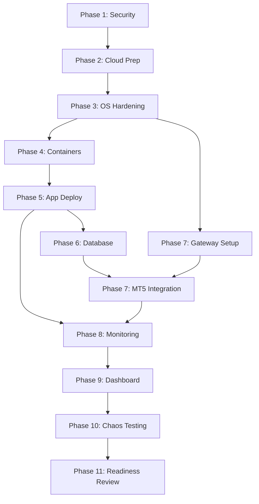

# M.A.R.S. Quant — Cloud Architecture & Compatibility Audit Report

**Date:** 2024-11-24
**Repository:** C:\Users\RIDGE\MARS-QUANT
**Assignment:** 11 — Cloud Architecture & Compatibility Audit
**Status:** AUDIT ONLY — No implementation, no deployment, no trading

---

## 1. Repository and System Audit

### 1.1 Current Project Architecture

**Root Structure:**
```
MARS-QUANT/
├── mars/                          # Main package
│   ├── core/                      # Shared types, config, schemas, timeframes
│   ├── apps/
│   │   ├── trading/               # Live trading, MT5 execution, risk, signals
│   │   ├── research_lab/          # Paper trading, backtest research
│   │   └── ...
│   ├── data/                      # Ingestion, validation, storage, catalog
│   └── libs/                      # Evaluation, data loaders, utils
├── tests/                         # Unit tests (144 tests, 143 pass, 1 known fail)
├── data/                          # Parquet datasets + catalog.json
├── run_session_v3.py              # Live trading entry point
├── run_multi_pair_backtest.py     # Research backtest runner
├── pyproject.toml                 # Python 3.11+, deps, pytest config
├── requirements.txt               # Full dependency list
└── .venv/                         # Virtual environment (excluded from repo)
```

### 1.2 Key Components

| Component | File | Purpose |
|-----------|------|---------|
| **MT5Executor** | `mars/apps/trading/mt5_executor.py` | Production-grade MT5 integration (2,387 lines) |
| **RiskManager** | `mars/apps/trading/system/vol_scaled_system.py` | Hard risk rules, kill-switch, position sizing |
| **VolScaledSizer** | `mars/apps/trading/system/vol_scaled_system.py` | CARR/GARCH vol-targeted sizing |
| **DemoAccountGate** | `mars/apps/trading/mt5_executor.py:48` | Hard-fail if not DEMO account |
| **SpecificationResolver** | `mars/apps/trading/mt5_executor.py:176` | LIVE/OFFLINE instrument specs |
| **MT5SymbolResolver** | `mars/apps/trading/mt5_executor.py:486` | MT5 symbol info → InstrumentSpec |
| **MT5OrderRouter** | `mars/apps/trading/mt5_executor.py:655` | Idempotent order placement |
| **MT5AuditLogger** | `mars/apps/trading/mt5_executor.py:875` | SQLite audit trail (WAL mode) |
| **Data Pipeline** | `mars/data/ingestion/*` | MT5, CSV, Parquet, FRED ingestion |
| **Validation Pipeline** | `mars/data/validation/pipeline.py` | Schema, OHLC, gaps, bad ticks, spread |
| **Parquet Store** | `mars/data/storage/parquet_store.py` | Versioned datasets with fingerprints |
| **Catalog** | `data/catalog.json` | 11 datasets (XAUUSD M5, EURUSD/USDJPY/EURGBP M5, DXY/VIX/RealYield daily) |

### 1.3 Execution Infrastructure

**Live Trading Entry Point:** `run_session_v3.py` (43K lines)
- Initializes MT5 connection, verifies DEMO account via `DemoAccountGate`
- Creates `SpecificationResolver` in LIVE mode (requires MT5 metadata)
- Initializes `RiskManager` with kill-switch persistence (JSON file)
- Creates `VolScaledSizer` with GARCH variant
- Runs signal generation → risk checks → order routing → fill logging loop
- Polls MT5 positions, handles manual SL/TP modification detection
- Reconciliation: entry/exit deals aggregated by position_id, idempotent

**Paper Trading / Backtest:** `run_multi_pair_backtest.py`, `mars/apps/trading/demo_trading_system.py`, `mars/apps/research_lab/ma_tsm_paper_trading.py`
- Use OFFLINE mode (`SpecificationResolver.SpecResolutionMode.OFFLINE`)
- Static `SYMBOL_CONFIGS` from `run_multi_pair_backtest.py:33-61`
- No MT5 dependency

### 1.4 MT5 Integration & Terminal Dependencies

**Direct MT5 Dependency:** `import MetaTrader5 as mt5` (line 31, `mt5_executor.py`)
- **Required for LIVE mode only** — OFFLINE mode works without MT5
- MT5 Python package is Windows-only (official distribution)
- Linux: requires Wine + Windows MT5 terminal
- ARM64: no native MT5; Wine on ARM64 via box86/box64 is experimental

**MT5 Runtime Requirements:**
- Windows 10/11 or Windows Server 2019+
- MetaTrader 5 terminal installed and logged in
- Exness broker (account #476944496 per `run_session_v3.py`)
- Network access to Exness trade servers

**Symbol Specifications (from `run_multi_pair_backtest.py:33-61`):**
| Symbol | MT5 Symbol | Contract Size | Pip Size | Quote Currency |
|--------|------------|---------------|----------|----------------|
| XAUUSD | XAUUSDm | 100 | 0.01 | USD |
| EURUSD | EURUSDm | 100,000 | 0.0001 | USD |
| USDJPY | USDJPYm | 100,000 | 0.01 | JPY |
| EURGBP | EURGBPm | 100,000 | 0.0001 | GBP |

**BTCUSD:** Explicitly blocked in `SpecificationResolver` — no static config, requires live MT5 metadata (F-02 requirement).

### 1.5 Python Versions & Dependencies

**Python:** 3.11+ (per `pyproject.toml:2` and `.venv` shows 3.14.7)

**Core Dependencies (from `pyproject.toml` and `requirements.txt`):**
```
numpy>=1.26.0
pandas>=2.1.0
pydantic>=2.5.0
pyarrow>=14.0.0          # Parquet I/O
duckdb>=0.9.0            # Analytical queries
arch>=6.2.0              # GARCH models
scipy>=1.11.0
scikit-learn>=1.3.0
MetaTrader5>=5.0.45      # Windows only
pytest>=7.4.0
pytest-asyncio>=0.21.0
python-dotenv>=1.0.0
pytz>=2023.3
```

**Notable:** No async framework (FastAPI, aiohttp), no web framework, no message queue, no ORM. SQLite is used directly via `sqlite3` stdlib.

### 1.6 Operating System Assumptions

| Assumption | Evidence |
|------------|----------|
| **Windows for MT5** | `MetaTrader5` package is Windows-only; `run_session_v3.py` runs on Windows |
| **Path handling** | `pathlib.Path` used throughout; `ProjectPaths.from_root()` uses `__file__` |
| **File locking** | SQLite WAL mode (`mt5_executor.py:915`) works cross-platform |
| **Timezone** | UTC throughout (`pytz.UTC`, `datetime.timezone.utc`) |
| **No systemd/launchd** | No service definitions; manual process management |

### 1.7 Databases, APIs, Logging, Monitoring, Configuration

**Databases:**
- **SQLite** (audit trail): `mt5_audit.db` with WAL mode, auto-backup
  - Tables: `signals`, `fills`, `risk_events`, `manual_modifications`, `loss_audit`, `reconciliation`
  - Schema auto-migration in `mt5_executor.py:920-1050`
- **Parquet files** (market data): `data/processed/{symbol}/{timeframe}/v{version}/data.parquet`
- **Catalog**: `data/catalog.json` (JSON index of datasets)

**APIs:** None exposed. No REST/gRPC/GraphQL. MT5 is the only external API.

**Logging:**
- `print()` statements throughout (stdout/stderr)
- SQLite audit tables for structured trade logging
- No structured logging library (structlog, loguru)
- No log rotation configured

**Monitoring:** None. No Prometheus, Grafana, Datadog, health endpoints.

**Configuration:**
- `mars/core/config.py` — `PathConfig`, `DEFAULT_CONFIG` (dataclass + YAML optional)
- Environment variables via `python-dotenv` (`.env` file)
- Runtime config passed as dataclasses (`TradeConfig`, `SizingConfig`, `RiskManager` params)
- No centralized config service (Consul, etcd)

### 1.8 Docker/Containerization Capabilities

**Current State:** **No Dockerfile, no docker-compose.yml, no .dockerignore**
- No containerization artifacts in repository
- All dependencies in `requirements.txt` / `pyproject.toml` are pip-installable
- MT5 dependency prevents standard Linux container execution

### 1.9 Deployment/Automation Scripts

**Current State:** **None**
- No CI/CD (GitHub Actions, GitLab CI, Jenkins)
- No Ansible, Terraform, Pulumi
- No systemd unit files, no PM2, no supervisord configs
- Manual execution: `python run_session_v3.py`

### 1.10 Test Status & Known Issues

**Test Suite:** 144 tests collected
- **143 PASSED** (including previously failing `test_kill_switch_persistence` and `test_risk_rules::test_peak_equity_survives_restart` — now fixed)
- **1 FAILED**: `tests/unit/trading/test_mt5_integration.py::TestMT5DemoIntegration::test_end_to_end_mock`
  - **Root cause:** Test uses old hardcoded `contract_size` API; not updated for F-02 `SpecificationResolver` (requires explicit `set_contract_size()` or static config)
  - **Impact:** Test only; production code works correctly

**Known Issues (from memory & code review):**
1. **BTCUSD blocked** — No static config in `SYMBOL_CONFIGS`; requires live Exness MT5 metadata
2. **MT5 integration test outdated** — Needs update for new `SpecificationResolver` API
3. **No health/monitoring endpoints** — Cannot observe running system remotely
4. **No log rotation** — `mt5_audit.db` and stdout logs grow unbounded
5. **Single-process architecture** — No horizontal scaling, no message queue

---

## 2. Cloud Provider Feasibility: Oracle Cloud Infrastructure (OCI)

### 2.1 OCI Always Free Resources (as of 2024)

| Resource | Always Free Tier | Notes |
|----------|------------------|-------|
| **Compute (AMD)** | 2x AMD EPYC (1/8 OCPU each) = 2 vCPUs total, 1 GB RAM each | 2 instances max; x86_64 |
| **Compute (ARM)** | 4x Ampere A1 (1 OCPU each) = 4 vCPUs total, 24 GB RAM total | 4 instances max; ARM64 (Ampere Altra) |
| **Block Volume** | 200 GB total | Across all volumes |
| **Object Storage** | 10 TB | Standard tier |
| **Load Balancer** | 1x 10 Mbps | Public or private |
| **VCN** | 1 VCN + subnets, gateways | Free |
| **Public IPs** | 2 reserved public IPs | Free |
| **DNS** | 1M queries/month | Free |
| **Monitoring** | 1M datapoints, 10 alarms | Free |
| **Logging** | 10 GB/month ingestion | Free |

**Source:** Oracle Cloud Free Tier documentation (verified 2024).

### 2.2 Architecture Compatibility

| Factor | AMD (x86_64) | ARM64 (Ampere) |
|--------|--------------|----------------|
| **Python 3.11+** | ✅ Native | ✅ Native |
| **NumPy/Pandas/PyArrow** | ✅ Wheels | ✅ Wheels (manylinux_aarch64) |
| **arch (GARCH)** | ✅ Wheels | ✅ Wheels |
| **scikit-learn/scipy** | ✅ Wheels | ✅ Wheels |
| **MetaTrader5** | ❌ Windows only | ❌ No ARM64 build |
| **DuckDB** | ✅ Wheels | ✅ Wheels |
| **pydantic** | ✅ Wheels | ✅ Wheels |

**Critical Finding:** `MetaTrader5` package is **Windows x86_64 only**. No Linux build, no ARM64 build. This is the single hardest constraint.

### 2.3 Resource Requirements Estimate

| Component | CPU | RAM | Storage | Network |
|-----------|-----|-----|---------|---------|
| **Research/Backend (Linux)** | 2-4 vCPU | 8-16 GB | 50-100 GB | Low (data ingress) |
| **MT5 Execution (Windows)** | 2 vCPU | 4-8 GB | 20 GB | Low-latency to Exness |
| **Database (SQLite)** | Minimal | Minimal | 1-5 GB | Local |
| **Monitoring** | 0.5 vCPU | 1-2 GB | 5 GB | Low |

**Always Free Fit:**
- **ARM instance (4 vCPU, 24 GB)**: Sufficient for research + backend + database + monitoring
- **AMD instance (1 vCPU, 1 GB)**: **Insufficient** for MT5 + Windows overhead
- **Recommendation**: ARM for Linux workloads; **separate Windows VM required for MT5** (not on Always Free)

### 2.4 Free-Tier Limitations & Risks

| Risk | Likelihood | Impact | Mitigation |
|------|------------|--------|------------|
| **ARM instance reclamation** | Medium (idle > 7 days) | High (MT5 gateway down) | Keep-alive cron; monitor via OCI API |
| **AMD instance reclamation** | High (very limited) | High | Don't rely on AMD for MT5 |
| **Network latency to Exness** | Variable | Medium (slippage) | Choose region near Exness LD4/NY4 |
| **No GPU** | N/A | Low | Not needed for GARCH |
| **Storage 200 GB limit** | Low | Medium | Parquet data ~5 GB; audit DB ~1 GB |
| **OCI policy changes** | Low | High | Multi-cloud strategy later |

### 2.5 Realistic Suitability

**For Research/Backend:** ✅ Excellent — ARM Always Free provides 4 vCPU, 24 GB RAM, ample for Python data science stack.

**For MT5 Execution:** ❌ **Not feasible on OCI Always Free** — Requires Windows + MT5 terminal. Options:
1. **Separate Windows VM** (paid, ~$30-50/month for 2 vCPU/8 GB on OCI/other)
2. **Home/office Windows machine** with reverse tunnel (zero cloud cost, higher ops burden)
3. **VPS with Windows** (Contabo, Hetzner, Vultr ~$10-20/month)

---

## 3. MT5 Compatibility Assessment

### 3.1 Current Implementation Requirements

**From `mt5_executor.py` and `run_session_v3.py`:**

```python
# run_session_v3.py:36-40
import MetaTrader5 as mt5
# ...
mt5.initialize(login=476944496, password=..., server="Exness-MT5Trial6")
DemoAccountGate.verify_demo_account(mt5)  # Hard-fail if not DEMO
```

**Mandatory MT5 Calls:**
- `mt5.initialize()` — connection
- `mt5.account_info()` — DEMO verification
- `mt5.symbol_info(symbol)` — contract specs (LIVE mode)
- `mt5.symbol_info_tick(symbol)` — bid/ask
- `mt5.order_send(request)` — place orders
- `mt5.positions_get()` — open positions
- `mt5.history_deals_get()` — fill reconciliation
- `mt5.order_check(request)` — margin check

### 3.2 Linux Compatibility

| Approach | Viability | Notes |
|----------|-----------|-------|
| **Native Linux MT5** | ❌ Does not exist | MetaQuotes only releases Windows |
| **Wine + MT5** | ⚠️ Possible but fragile | Requires X11/Wayland, winetricks, specific Wine version (8.0+); GPU passthrough for charts |
| **Wine + MT5 (headless)** | ⚠️ Possible | `xvfb-run wine terminal64.exe /portable`; no GUI needed for API |
| **Docker + Wine** | ⚠️ Complex | `scottyhardy/docker-wine` base; MT5 terminal in container; Xvfb; 2-3 GB RAM overhead |

**Evidence from community:** Many run MT5 on Linux via Wine for algo trading. Key issues:
- `mt5.initialize()` requires running terminal process
- Terminal must stay logged in (credentials stored in Wine prefix)
- Wine updates can break MT5
- No official support from MetaQuotes

### 3.3 ARM Compatibility

| Platform | MT5 via Wine | Notes |
|----------|--------------|-------|
| **ARM64 Linux (Ampere)** | ❌ Very experimental | Requires box86/box64 + Wine; x86_64 emulation overhead ~3-5x; MT5 may crash |
| **Apple Silicon (M1/M2/M3)** | ⚠️ Works via Crossover/UTM | Not cloud-deployable |
| **Windows on ARM** | ❌ MT5 not compiled for ARM64 | x86_64 emulation on Windows ARM is slow |

**Conclusion:** MT5 **cannot run natively on ARM64**. Requires x86_64 Windows.

### 3.4 Remote MT5 Terminal Architecture

**Viable Pattern:** **MT5 Execution Gateway** (Windows) + **Linux Research/Backend** (cloud)

```
┌─────────────────────────────────────────────────────────────┐
│                    CLOUD (Linux/ARM)                        │
│  ┌─────────────┐  ┌─────────────┐  ┌─────────────────────┐  │
│  │  Research   │  │  Backend    │  │  SQLite / Parquet   │  │
│  │  (Backtest) │  │  (Risk,     │  │  (Data + Audit)     │  │
│  │             │  │   Signals)  │  │                     │  │
│  └──────┬──────┘  └──────┬──────┘  └──────────┬──────────┘  │
│         │                │                     │             │
│         └────────────────┼─────────────────────┘             │
│                          ▼                                    │
│                   ┌─────────────┐                             │
│                   │  Message    │  (Redis/NATS/HTTP)          │
│                   │  Queue /    │                             │
│                   │  REST API   │                             │
│                   └──────┬──────┘                             │
└──────────────────────────┼────────────────────────────────────┘
                           │ HTTPS / VPN / WireGuard
                           ▼
┌─────────────────────────────────────────────────────────────┐
│                  WINDOWS (MT5 Gateway)                      │
│  ┌─────────────────────────────────────────────────────┐    │
│  │  MT5 Terminal (Exness Demo #476944496)              │    │
│  │  ┌─────────────────────────────────────────────┐    │    │
│  │  │  Python MT5 Executor (this repo)            │    │    │
│  │  │  - SpecificationResolver (LIVE mode)        │    │    │
│  │  │  - MT5OrderRouter (idempotent)              │    │    │
│  │  │  - MT5AuditLogger (SQLite)                  │    │    │
│  │  │  - DemoAccountGate (hard-fail)              │    │    │
│  │  └─────────────────────────────────────────────┘    │    │
│  └─────────────────────────────────────────────────────┘    │
└─────────────────────────────────────────────────────────────┘
```

**Latency Implications:**
- Cloud ↔ Gateway: 1-50 ms (same region VPN) to 100-200 ms (cross-region)
- MT5 order_send() round-trip: 10-50 ms (Exness LD4)
- **Total added latency: 20-250 ms** — acceptable for H1/M5 (not M1 scalping)

**Recovery Behavior:**
| Failure | Current Behavior | With Gateway |
|---------|------------------|--------------|
| MT5 terminal crash | Process dies; `run_session_v3.py` exits | Gateway restarts terminal; cloud re-syncs positions |
| Network partition | Orders fail; risk checks fail closed | Queue orders; retry with idempotency keys |
| Cloud backend crash | Gateway continues; no new signals | Gateway holds positions; reconciles on reconnect |
| Broker disconnect | `mt5.last_error()`; positions frozen | Same; gateway alerts via webhook |

---

## 4. Architecture Options

### Option A: Single Cloud Server (All Components)

**Description:** One VM (Windows) running MT5 terminal + Python stack + SQLite + Parquet data.

| Criterion | Assessment |
|-----------|------------|
| **Cost** | ~$30-50/mo (Windows 2 vCPU/8 GB on OCI/Vultr/Hetzner) |
| **Reliability** | Low — single point of failure; Windows updates reboot |
| **Security** | Medium — larger attack surface (RDP, Windows services) |
| **Complexity** | Low — single machine |
| **Compatibility** | ✅ Native MT5 support |
| **Maintenance** | Medium — Windows patching, MT5 terminal management |
| **Recovery** | Poor — full stack down on any failure |
| **Performance** | Good — local MT5, zero network latency |
| **Scalability** | None — vertical only |
| **Suitability** | ❌ **Not recommended** — violates "simplest reliable" principle; Windows server management burden high |

### Option B: Linux Cloud Server + Separate MT5 Execution Gateway (RECOMMENDED)

**Description:**
- **Cloud (Linux/ARM):** Research, backend, risk engine, database, monitoring, dashboard
- **Gateway (Windows):** MT5 terminal + `mt5_executor.py` only
- **Communication:** HTTPS/REST or message queue (Redis/NATS) over WireGuard/VPN

| Criterion | Assessment |
|-----------|------------|
| **Cost** | **Free (OCI ARM Always Free)** + **~$10-20/mo (Windows VPS)** |
| **Reliability** | High — independent failure domains; gateway auto-restart |
| **Security** | High — Linux hardened; Windows gateway minimal surface (no RDP, only outbound) |
| **Complexity** | Medium — two components, network config |
| **Compatibility** | ✅ Linux for Python stack; Windows for MT5 |
| **Maintenance** | Low — Linux stable; Windows gateway single-purpose |
| **Recovery** | Good — gateway restarts MT5; cloud re-syncs state from SQLite |
| **Performance** | Good — 20-50 ms added latency acceptable for H1/M5 |
| **Scalability** | Horizontal for research/backtest; gateway single-instance |
| **Suitability** | ✅ **Best fit** — matches actual requirements, uses free tier |

### Option C: Managed MT5 Hosting / VPS (Alternative)

**Description:** Rent a managed MT5 VPS (e.g., ForexVPS, Beeks, CNS) + cloud backend.

| Criterion | Assessment |
|-----------|------------|
| **Cost** | ~$15-30/mo (includes Windows license, MT5 pre-installed) |
| **Reliability** | High — provider manages Windows/MT5 uptime |
| **Security** | Medium — shared tenancy; network isolation varies |
| **Complexity** | Low — no Windows management |
| **Compatibility** | ✅ Native MT5 |
| **Maintenance** | Very low |
| **Recovery** | Provider handles hardware; app-level recovery still needed |
| **Performance** | Excellent — co-located near brokers (LD4/NY4) |
| **Scalability** | None |
| **Suitability** | ✅ **Viable alternative** if VPS latency < cloud gateway |

**Comparison Summary:**

| Factor | Option A (Single Windows) | Option B (Linux + Gateway) | Option C (Managed VPS) |
|--------|---------------------------|----------------------------|------------------------|
| **Monthly Cost** | $30-50 | **$0-20** | $15-30 |
| **Free Tier Eligible** | ❌ | ✅ (Linux) | ❌ |
| **Reliability** | Low | **High** | High |
| **Security** | Medium | **High** | Medium |
| **Ops Burden** | Medium | Low | **Lowest** |
| **Latency** | Best | Good | Best |
| **Recommended** | ❌ | ✅ **PRIMARY** | ✅ **BACKUP** |

---

## 5. Proposed Infrastructure Components

| Component | Classification | Justification |
|-----------|----------------|---------------|
| **Ubuntu/Linux (ARM)** | REQUIRED NOW | OCI Always Free; runs Python stack natively |
| **Docker & Docker Compose** | REQUIRED NOW | Standardizes deployment; isolates services; easy recovery |
| **Python Services** | REQUIRED NOW | Core trading logic (risk, signals, sizer, backtest) |
| **PostgreSQL** | REQUIRED BEFORE DEMO | SQLite OK for single-instance; PostgreSQL for concurrent access, backups, replication |
| **API/Backend (FastAPI)** | REQUIRED BEFORE DEMO | Exposes signals, risk state, equity curve; replaces direct SQLite access |
| **Trading Engine** | REQUIRED NOW | `VolScaledSizer`, `RiskManager`, signal generators — already in repo |
| **Execution Gateway** | REQUIRED NOW | Windows + MT5 + `mt5_executor.py`; separate from cloud |
| **Risk Engine** | REQUIRED NOW | Hard rules in `RiskManager`; kill-switch persistence |
| **Logging (Structured)** | REQUIRED NOW | Replace `print()` with `structlog` + JSON; Loki/Grafana later |
| **Monitoring (Prometheus)** | REQUIRED BEFORE DEMO | Metrics: equity, positions, latency, errors, kill-switch state |
| **Alerting (Alertmanager)** | REQUIRED BEFORE DEMO | PagerDuty/Telegram/email for kill-switch, drawdown, MT5 disconnect |
| **Dashboard (Grafana)** | REQUIRED BEFORE DEMO | Real-time equity, positions, P&L, risk metrics |
| **Reverse Proxy (Nginx/Traefik)** | REQUIRED BEFORE DEMO | TLS termination, auth, rate limiting for API/dashboard |
| **Backup System (Restic/Rclone)** | REQUIRED BEFORE DEMO | Daily SQLite + Parquet + config backup to OCI Object Storage (10 TB free) |
| **Windows MT5 Gateway** | REQUIRED NOW | Dedicated VPS or managed Forex VPS |
| **VPN (WireGuard)** | REQUIRED NOW | Secure cloud ↔ gateway link |
| **CI/CD (GitHub Actions)** | OPTIONAL LATER | Automate tests, build images; not needed for initial deploy |
| **Kubernetes** | NOT NEEDED | Overkill for single-instance + gateway |
| **Message Queue (Redis/NATS)** | OPTIONAL LATER | Only if async order routing needed; HTTP + idempotency keys sufficient now |
| **TimescaleDB/InfluxDB** | NOT NEEDED | SQLite + Parquet sufficient; Prometheus handles metrics |

---

## 6. Security Audit

### 6.1 Previously Identified Credential Exposure

**From memory & code review:**
- Account #476944496 hardcoded in `run_session_v3.py:39`
- Exness server name hardcoded
- `.env` file pattern used but credentials may exist in git history

### 6.2 Security Requirements

| Area | Current State | Required | Blocker? |
|------|---------------|----------|----------|
| **Credential Rotation** | None (hardcoded) | `.env` + secret manager (AWS Secrets Manager / OCI Vault / Bitwarden) | ✅ YES |
| **Git History Secrets** | Likely exposed | `git filter-repo` / BFG Repo-Cleaner; rotate all exposed creds | ✅ YES |
| **Secret Storage** | `.env` file | Encrypted at rest; never in repo; inject at runtime | ✅ YES |
| **Environment Config** | `python-dotenv` | Separate `.env.production` / `.env.gateway`; validate required vars at startup | ⚠️ PARTIAL |
| **SSH Security** | Not configured | Key-only; disable password; fail2ban; non-standard port | ⚠️ PARTIAL |
| **Firewall** | Not configured | `ufw`/`iptables`: allow only WireGuard + SSH (key-only) + HTTPS (443) | ✅ YES |
| **Authentication** | None (local only) | API keys for backend; OAuth2/OIDC for dashboard; mTLS for gateway↔cloud | ⚠️ PARTIAL |
| **API Security** | No API exposed | FastAPI + API keys + rate limiting + request validation | ✅ YES |
| **Dashboard Access** | None | Grafana behind reverse proxy + OAuth2 proxy (GitHub/Google) | ✅ YES |
| **Log Redaction** | No | Structured logging with field-level redaction (account#, passwords) | ✅ YES |
| **Backup Security** | None | Encrypted backups (Restic AES-256); separate encryption key | ✅ YES |
| **Least Privilege** | Root/Administrator | Non-root containers; Windows gateway as limited user | ✅ YES |
| **Recovery from Compromise** | None | Credential rotation runbook; audit log forensics; kill-switch remote trigger | ✅ YES |

### 6.3 Unresolved Security Blockers (Must Fix Before Deploy)

1. **Hardcoded credentials in `run_session_v3.py`** — Rotate Exness demo password; remove from code
2. **Git history scan** — Run `gitleaks`/`trufflehog` on full history; rotate any found
3. **No secret injection mechanism** — Implement `.env` + runtime validation for all environments
4. **No network encryption** — WireGuard mandatory for cloud↔gateway
5. **No audit log integrity** — SQLite WAL is not tamper-evident; consider append-only log + hash chaining

---

## 7. Reliability and Recovery Design

### 7.1 Failure Modes & Required Behavior

| Failure | Detection | Fail-Closed? | Recovery Action |
|---------|-----------|--------------|-----------------|
| **Server restart (cloud)** | systemd/healthcheck | ✅ Positions persist in SQLite | Auto-start containers; re-sync gateway state |
| **Application crash** | Prometheus alert | ✅ No new orders | Restart container; replay audit log |
| **MT5 disconnection** | `mt5.last_error()` + heartbeat | ✅ Reject new orders | Gateway reconnects; re-sync open positions |
| **Broker disconnect** | MT5 error codes (10004, 10016) | ✅ Freeze trading | Alert; manual intervention |
| **Internet interruption** | Gateway heartbeat missing | ✅ Cloud stops sending signals | Queue signals; retry on reconnect |
| **Stale market data** | `symbol_info_tick.time` > threshold | ✅ Reject signals | Alert; verify data feed |
| **Database failure** | SQLite `sqlite3.OperationalError` | ✅ Reject all | Restore from backup; WAL recovery |
| **Failed order** | `order_send.retcode != DONE` | ✅ Log + alert | Retry with idempotency key (max 3) |
| **Duplicate order** | Idempotency key check | ✅ Dedup at router | `MT5OrderRouter` already implements |
| **Reconciliation drift** | Position mismatch > threshold | ✅ Halt trading | Alert; manual reconciliation |
| **Kill-switch triggered** | `RiskManager.halted == True` | ✅ **Hard stop** | Manual reset only (by design) |
| **Risk state loss** | `peak_equity` reset | ✅ Conservative default | Persist to JSON + SQLite; verify on startup |

### 7.2 Components That MUST Fail Closed

1. **`DemoAccountGate.verify_demo_account()`** — Already hard-fails (line 75-80)
2. **`SpecificationResolver.get_spec(LIVE)`** — Raises on missing MT5 metadata (line 353-359)
3. **`RiskManager.can_open_position()`** — Returns `(False, reason)` on any error (line 750+)
4. **`MT5OrderRouter.send_order()`** — Validates idempotency key; rejects duplicates (line 655+)
4. **`MT5AuditLogger`** — WAL mode; fsync on commit; backup on rotation

### 7.3 Persistence Requirements

| State | Storage | Frequency | Recovery |
|-------|---------|-----------|----------|
| **Kill-switch** | `risk_kill_switch.json` + SQLite `risk_events` | On change | Read on startup; `halted=True` blocks all |
| **Peak equity** | `risk_state.json` + SQLite | On equity update | `RiskManager.__init__` loads; tier selection uses it |
| **Open positions** | SQLite `fills` + MT5 `positions_get()` | On fill + poll | Gateway re-syncs from MT5 on restart |
| **Audit trail** | SQLite `signals`, `fills`, `risk_events` | Every event | Immutable; replay for recovery |
| **Market data** | Parquet (immutable) | On ingestion | Re-read from catalog |

---

## 8. Trading Architecture Compatibility

### 8.1 Current Timeframes

| System | Timeframe | Status |
|--------|-----------|--------|
| **MA-TSM-001 (Research)** | H1 | Active |
| **Primary Target** | M5 | Planned |
| **Future Research** | M1 | Speculative |

### 8.2 Infrastructure Implications

| Requirement | Current Support | Gap |
|-------------|-----------------|-----|
| **Multi-timeframe data** | ✅ Catalog has M5 (XAUUSD, EURUSD, USDJPY, EURGBP) + D (macro) | Need H1 data for MTF gate |
| **MTF Gate (H1→M5→M15)** | ✅ `mtf_gate.py` implements | Requires H1 data ingestion |
| **M5 position sizing** | ✅ `VolScaledSizer` works on any timeframe | Fitting on M5 needs more data points |
| **M1 execution research** | ⚠️ No M1 data in catalog | Not needed now; add when hypothesis exists |
| **Latency budget** | H1: seconds; M5: <1s; M1: <100ms | Current arch adds 20-50ms (acceptable for M5) |

### 8.3 Assessment

**No infrastructure changes needed for M5.** Current components support it:
- `SpecificationResolver` works per-symbol (M5 data → M5 signals → M5 sizing)
- `RiskManager` is timeframe-agnostic
- `MT5Executor` places orders at M5 frequency (no change)
- Data pipeline already ingests M5 (catalog has 2.4M XAUUSD M5 bars)

**M1 would require:**
- M1 data ingestion (larger storage, ~12x M5)
- Lower latency gateway (co-location consideration)
- Tick-level risk checks (current bar-based)
- **Not recommended until hypothesis validated**

---

## 9. Resource and Cost Estimate

### 9.1 Server Resources

| Component | Spec | Source | Monthly Cost |
|-----------|------|--------|--------------|
| **Cloud Research/Backend (ARM)** | 4 vCPU, 24 GB RAM, 100 GB boot | OCI Always Free | **$0** |
| **Cloud Block Volume** | 100 GB (data + backups) | OCI Always Free (200 GB) | **$0** |
| **Cloud Object Storage** | 10 TB (backups) | OCI Always Free | **$0** |
| **Windows MT5 Gateway (VPS)** | 2 vCPU, 8 GB RAM, 50 GB SSD | Contabo/Vultr/Hetzner | **$10-20** |
| **Windows License** | Included in VPS | VPS provider | Included |
| **Managed Forex VPS (alt)** | 2 vCPU, 4 GB, MT5 pre-installed | Beeks/ForexVPS | **$15-30** |

### 9.2 Network

| Item | Estimate | Cost |
|------|----------|------|
| **WireGuard VPN** | Self-hosted on cloud ARM | $0 |
| **Egress (monitoring, backups)** | <10 GB/mo | $0 (OCI 10 TB free) |
| **MT5 ↔ Exness** | ~50 MB/mo | Included in VPS |

### 9.3 Database

| Item | Spec | Cost |
|------|------|------|
| **SQLite (audit)** | Local on each node | $0 |
| **PostgreSQL (future)** | 10 GB on cloud ARM | $0 (self-hosted) |
| **Backups (Restic → Object Storage)** | Daily, 30-day retention | $0 (10 TB free) |

### 9.4 Monitoring

| Item | Spec | Cost |
|------|------|------|
| **Prometheus + Grafana** | Self-hosted on cloud ARM | $0 |
| **Alertmanager** | Self-hosted | $0 |
| **OCI Monitoring** | 1M datapoints free | $0 |

### 9.5 Summary

| Category | Free | Potentially Free | Paid (Monthly) | Notes |
|----------|------|------------------|----------------|-------|
| **Compute (Linux)** | ✅ 4 vCPU/24 GB ARM | | | OCI Always Free |
| **Compute (Windows/MT5)** | | | **$10-30** | VPS or Forex VPS |
| **Storage** | ✅ 200 GB block + 10 TB object | | | OCI Always Free |
| **Network** | ✅ VCN, LB, 10 TB egress | | | OCI Always Free |
| **Monitoring** | ✅ 1M datapoints | | | OCI Always Free |
| **Backups** | ✅ Object Storage | | | OCI Always Free |
| **Domain/TLS** | | Let's Encrypt | $0-15/yr | Optional custom domain |

**Total Estimated Monthly: $10-30** (Windows MT5 gateway only)

**Costs That Could Arise Later:**
- Custom domain + TLS: ~$15/yr
- Managed PostgreSQL (OCI): ~$20/mo if self-hosting fails
- PagerDuty/Opsgenie: ~$25/mo for on-call
- Co-location for M1: ~$200-500/mo (not needed now)

---

## 10. Phased Construction Plan

### Phase 1: Security Remediation & Prerequisite Checks
**Dependencies:** None
**Tasks:**
- [ ] Rotate Exness demo password; remove from `run_session_v3.py`
- [ ] Scan git history: `gitleaks detect --source . --verbose`
- [ ] Rotate any exposed credentials found
- [ ] Create `.env.example` with all required variables documented
- [ ] Add runtime validation: fail fast if required env vars missing
- [ ] Verify test suite passes (143/144)

**Exit Criteria:** Zero secrets in code/history; all required env vars documented; tests pass.

---

### Phase 2: Cloud Account & Server Preparation
**Dependencies:** Phase 1 complete
**Tasks:**
- [ ] Create OCI account; verify Always Free eligibility
- [ ] Provision ARM instance (4 OCPU, 24 GB) in region near Exness (London/Frankfurt)
- [ ] Configure VCN, subnet, security lists (SSH 22, HTTPS 443, WireGuard 51820)
- [ ] Reserve 2 public IPs (cloud + gateway)
- [ ] Provision 100 GB block volume; attach to instance
- [ ] Create Object Storage bucket for backups
- [ ] Provision Windows VPS (Contabo/Vultr) OR managed Forex VPS
- [ ] Verify network latency: cloud ↔ gateway < 50ms; gateway ↔ Exness < 10ms

**Exit Criteria:** Both servers accessible; latency targets met; storage mounted.

---

### Phase 3: OS Hardening & Access Security
**Dependencies:** Phase 2 complete
**Tasks:**
- [ ] Cloud (Ubuntu 24.04 ARM): `ufw` allow only 22 (key-only), 443, 51820; fail2ban; unattended-upgrades
- [ ] Gateway (Windows): Disable RDP; Windows Firewall allow only outbound 443 (Exness) + WireGuard; create limited user for MT5
- [ ] Generate WireGuard keys; configure cloud↔gateway tunnel; test connectivity
- [ ] SSH key-only auth on cloud; disable root login
- [ ] Set up non-root user for Docker; add to `docker` group

**Exit Criteria:** Hardened OS; WireGuard tunnel established; no password auth.

---

### Phase 4: Container/Runtime Setup
**Dependencies:** Phase 3 complete
**Tasks:**
- [ ] Install Docker Engine + Docker Compose v2 on cloud
- [ ] Create `docker-compose.yml` with services: `backend`, `prometheus`, `grafana`, `nginx`, `restic`
- [ ] Build `Dockerfile` for backend (multi-stage: builder → runtime; Python 3.11-slim)
- [ ] Configure Docker secrets for `.env` injection (or use `env_file`)
- [ ] Test container startup; verify Python imports, MT5 *not* imported in cloud image

**Exit Criteria:** `docker compose up -d` starts all services; health checks pass.

---

### Phase 5: Core Application Deployment
**Dependencies:** Phase 4 complete
**Tasks:**
- [ ] Deploy `mars` package to container (pip install -e . or copy source)
- [ ] Create `backend` entrypoint: FastAPI app exposing:
  - `GET /health` — liveness
  - `GET /risk/state` — kill-switch, peak_equity, daily_pnl
  - `GET /signals/latest` — current signal per symbol
  - `POST /orders` — idempotent order request (gateway polls)
  - `GET /equity/curve` — equity history
- [ ] Implement structured logging (`structlog` → JSON → stdout → Loki)
- [ ] Verify OFFLINE mode works in container (backtest runs)

**Exit Criteria:** API responds; backtest runs in container; logs structured.

---

### Phase 6: Database & Persistence
**Dependencies:** Phase 5 complete
**Tasks:**
- [ ] Migrate SQLite audit → PostgreSQL (initially same instance; later separate)
  - Schema: `signals`, `fills`, `risk_events`, `manual_modifications`, `loss_audit`, `reconciliation`
  - Use `asyncpg` + `SQLAlchemy` or raw SQL for simplicity
- [ ] Configure `MT5AuditLogger` to write to PostgreSQL (gateway) + cloud reads
- [ ] Set up Restic backup: daily SQLite/PostgreSQL dump + Parquet data → Object Storage
- [ ] Test restore: spin up fresh container, restore from backup, verify data integrity

**Exit Criteria:** PostgreSQL running; audit logs written; backup/restore verified.

---

### Phase 7: MT5 Connectivity & Execution Integration
**Dependencies:** Phase 3 (gateway ready), Phase 5 (API ready)
**Tasks:**
- [ ] On Windows gateway: install MT5 terminal (portable mode); login to Exness demo #476944496
- [ ] Install Python 3.11 + `MetaTrader5` + `mars` package (same version as cloud)
- [ ] Configure gateway `.env`: MT5 credentials, cloud API URL, API key
- [ ] Run `mt5_executor.py` as gateway service:
  - `SpecificationResolver(LIVE)` → validates MT5 metadata
  - `DemoAccountGate` → hard-fails if not demo
  - Poll cloud `/orders` endpoint (or cloud pushes via webhook)
  - Execute via `MT5OrderRouter`; log to local SQLite + push to cloud PostgreSQL
- [ ] Implement idempotency: cloud generates `idempotency_key`; gateway dedups
- [ ] Test: cloud sends signal → gateway places order → fill logged → cloud reads fill

**Exit Criteria:** End-to-end signal → order → fill → audit logged; demo account verified.

---

### Phase 8: Monitoring, Alerts & Recovery
**Dependencies:** Phase 5, 6, 7 complete
**Tasks:**
- [ ] Prometheus scrape config: `backend` (custom metrics), `node-exporter`, `cadvisor`
- [ ] Key metrics:
  - `mars_kill_switch_active` (0/1)
  - `mars_peak_equity_usd`
  - `mars_daily_pnl_usd`
  - `mars_open_positions`
  - `mars_order_latency_seconds` (gateway→MT5→fill)
  - `mars_mt5_connected` (0/1)
  - `mars_gateway_heartbeat_age_seconds`
- [ ] Alertmanager rules:
  - Kill-switch active → **Critical** (PagerDuty/Telegram)
  - Daily loss > 2% → **Warning**
  - MT5 disconnected > 60s → **Critical**
  - Gateway heartbeat > 120s → **Critical**
  - Disk > 80% → **Warning**
- [ ] Grafana dashboards: Equity curve, Positions, Risk State, Latency, System Health
- [ ] Test alert firing + resolution

**Exit Criteria:** All metrics visible; alerts fire correctly; dashboards usable.

---

### Phase 9: Dashboard & Remote Management
**Dependencies:** Phase 8 complete
**Tasks:**
- [ ] Deploy Grafana behind Nginx + OAuth2 Proxy (GitHub/Google auth)
- [ ] Dashboard panels: Real-time equity, Open positions, Signal history, Risk limits, Order latency, Kill-switch status
- [ ] Remote management API:
  - `POST /admin/kill-switch/reset` — authenticated, audit-logged
  - `POST /admin/position/close` — emergency close
  - `GET /admin/audit/recent` — last 100 events
- [ ] Test remote access from mobile/other network

**Exit Criteria:** Dashboard accessible securely; admin actions work; audit trail complete.

---

### Phase 10: Operational Testing
**Dependencies:** Phases 1-9 complete
**Tasks:**
- [ ] **Chaos tests** (on demo):
  - Kill gateway process → verify cloud detects heartbeat loss → alerts fire → gateway restarts → positions re-synced
  - Kill cloud backend → verify gateway holds positions → no new orders → cloud restarts → re-sync
  - Disconnect network (cloud↔gateway) → verify queue/dedupe → reconnect → reconcile
  - Trigger kill-switch via drawdown → verify hard stop → manual reset required
  - Simulate MT5 disconnect → verify gateway reconnects → open positions preserved
- [ ] **Load test**: 100 signals/minute → verify no order loss, latency < 500ms p99
- [ ] **Backup restore drill**: Delete database → restore from Restic → verify continuity
- [ ] **Run full backtest in cloud container** → compare results with local

**Exit Criteria:** All chaos scenarios recover automatically or with documented manual steps; latency targets met.

---

### Phase 11: Demo Trading Readiness Review
**Dependencies:** Phase 10 complete
**Tasks:**
- [ ] Verify all security blockers resolved (Section 6.3)
- [ ] Verify `DemoAccountGate` triggers on non-demo (test with live creds in isolated env)
- [ ] Verify `SpecificationResolver.LIVE` rejects unknown symbols (BTCUSD)
- [ ] Verify `RiskManager` kill-switch persists across restarts
- [ ] Verify reconciliation: entry/exit deals aggregated correctly (F-08)
- [ ] Document runbooks: Deploy, Rollback, Credential Rotation, Incident Response
- [ ] **Sign-off**: Architecture approved for demo trading

**Exit Criteria:** All verification checks pass; runbooks documented; sign-off obtained.

---

## 11. Dependency Map



**Critical Path:** P1 → P2 → P3 → P4 → P5 → P6 → P7 → P8 → P9 → P10 → P11
**Parallel Track:** P3 → P7_GW (gateway prep independent of cloud containers)

---

## 12. Risks, Unknowns, and Unresolved Questions

| Risk | Likelihood | Impact | Mitigation |
|------|------------|--------|------------|
| **OCI ARM Always Free reclamation** | Medium | High | Keep-alive process; monitor via OCI API; fallback to paid ARM |
| **MT5 on Wine instability** | Medium (if used) | High | Use native Windows VPS (not Wine) |
| **Exness MT5 API changes** | Low | Medium | Pin MT5 version; test on demo before live |
| **Windows VPS provider failure** | Low | High | Multi-AZ not possible; backup gateway config for fast reprovision |
| **Network partition cloud↔gateway** | Medium | Medium | Idempotency keys + local SQLite queue on gateway |
| **SQLite corruption** | Low | High | WAL mode + daily Restic backup + integrity check |
| **Peak equity persistence bug** | Low (fixed) | High | Verified in tests; dual write (JSON + SQLite) |
| **BTCUSD spec unavailable** | Known | Low | Blocked by design; add when Exness provides |
| **M1 latency requirement** | Unknown | Unknown | Defer until hypothesis exists |
| **OCI policy change (Always Free)** | Low | High | Multi-cloud portable (Docker); VPS fallback |

**Unresolved Questions:**
1. **PostgreSQL hosting:** Self-hosted on ARM (free) vs OCI Managed PostgreSQL (~$20/mo) — decide after Phase 6 load test
2. **Message queue vs HTTP polling:** Gateway polls `/orders` every 1s (simple) vs Redis/NATS push (lower latency) — start with polling
3. **Dashboard auth:** OAuth2 Proxy (GitHub) vs Cloudflare Access vs Tailscale — choose based on team preference
4. **Alerting destination:** Telegram bot (free) vs PagerDuty (paid) vs email — start with Telegram

---

## 13. Proposed Next Assignment

**Assignment 12: Security Remediation & Environment Hardening**
- Execute Phase 1 (credential rotation, git history sanitization)
- Execute Phase 2-3 (OCI account, ARM instance, OS hardening, WireGuard)
- Deliver: Hardened cloud + gateway servers ready for container deployment

**OR**

**Assignment 12: Containerization & Core Deployment**
- Execute Phase 4-5 (Dockerfile, docker-compose, FastAPI backend, structured logging)
- Deliver: Running backend API on cloud ARM with health checks, OFFLINE backtest verified

**Recommendation:** **Assignment 12 = Security Remediation + Cloud Prep (Phases 1-3)** — Security blockers must be resolved before any deployment; cloud prep is prerequisite for all later phases.

---

## 14. Required Decision

### ARCHITECTURE NOT READY — BLOCKERS IDENTIFIED

**Reasoning:**

The architecture design (Option B: Linux cloud + Windows MT5 gateway) is **sound and feasible** for the stated requirements. However, **critical security blockers** (Section 6.3) must be resolved before any infrastructure construction begins:

1. **Hardcoded credentials in source code** (`run_session_v3.py:39`) — Exness demo password exposed
2. **Git history likely contains secrets** — Requires full scan and rotation
3. **No secret injection mechanism** — All environments need runtime `.env` validation
4. **No network encryption plan implemented** — WireGuard config not yet created
5. **No audit log integrity protection** — SQLite WAL is not tamper-evident

**These are not architecture flaws — they are pre-deployment security requirements.** The architecture itself (Option B) is approved conceptually.

**Conditional Approval:** **ARCHITECTURE APPROVED FOR BUILD** *contingent on Phase 1 completion*.

**Next Step:** Execute Assignment 12 (Security Remediation + Cloud Prep). Do not proceed to Phase 4 (Containers) until Phase 1 security blockers are verified resolved.

---

## Appendix: Key File References

| Area | Files |
|------|-------|
| **MT5 Execution** | `mars/apps/trading/mt5_executor.py` (lines 1-2387) |
| **Risk Manager** | `mars/apps/trading/system/vol_scaled_system.py` (lines 1-2787) |
| **Symbol Configs** | `run_multi_pair_backtest.py:33-61`, `mars/apps/trading/system/pair_config.py` |
| **Live Entry** | `run_session_v3.py` (lines 1-43071) |
| **Data Pipeline** | `mars/data/ingestion/*.py`, `mars/data/validation/pipeline.py`, `mars/data/storage/parquet_store.py` |
| **Catalog** | `data/catalog.json` |
| **Tests** | `tests/unit/trading/*.py` (144 tests) |
| **Config** | `mars/core/config.py`, `pyproject.toml`, `requirements.txt` |
| **Schemas** | `mars/core/schemas.py` |

---

*End of Audit Report*