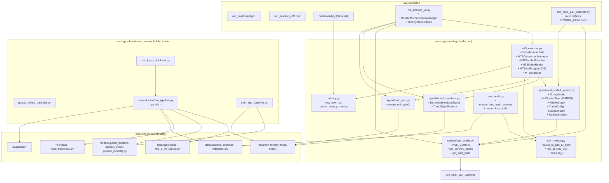
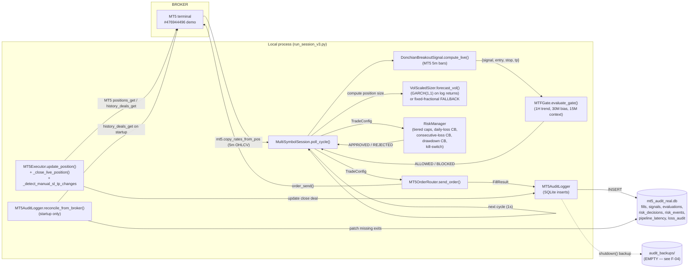
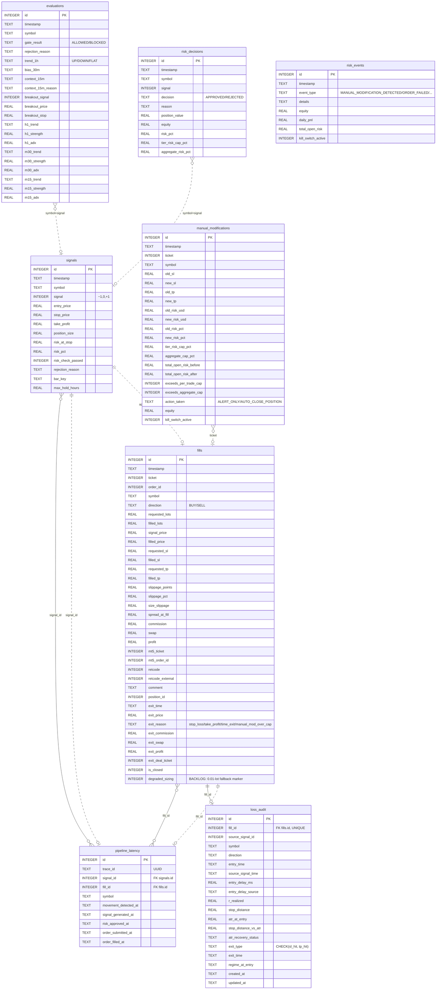

# M.A.R.S. — Repository & Architecture Audit

**Audit date:** 2026-10-10
**Scope:** complete, evidence-based audit of the entire M.A.R.S. repository before the planned 6 November system upgrade.
**Method:** read-only inspection of source files, configs, live audit DB, and execution entry points; smoke imports of all production modules under Python 3.14.7; safe subset of `pytest` (`tests/unit/trading/test_mt5_integration.py` excluded because it requires a live MT5 terminal).
**Status legend:** ✅ verified · ⚠ verified with caveat · 📌 inferred / claim from docstring / unverified.

> **No source code was modified.** The audit re-discovered two real test failures and several documented-but-unfixed bugs; those are reported, not patched.

---

## 1. Repository inventory

### 1.1 Top-level layout

| Path | Type | Last write | Notes |
| --- | --- | --- | --- |
| `pyproject.toml` | config | — | Name `mars-quant`, `requires-python=">=3.10"`, packages-find `mars*`. ✅ |
| `requirements.txt` | config | — | Declared runtime + research deps; `pandas_ta`, `torch`, `backtesting`, `mplfinance`, `fastparquet` are commented "not required for live trading". ✅ |
| `requirements_actual.txt` | config | — | Pinned versions actually present in venv. **Python is 3.14.7 but `arch==8.0.0` and `pandas==3.0.5` are in the lockfile** — verify wheels actually load (smoke import succeeded ✅). |
| `.env` | secrets | — | ⚠ Contains real credentials in plaintext (`DEMO_ACCOUNT_NUMBER=476944496`, `PASSWORD=dela.RIDGE1`, `SERVER=Exness-MT5Trial9`, `FRED_API_KEY=…`). Tracked in repo (not in `.gitignore`). See Finding F-12. |
| `.env.example` | template | — | Placeholder credentials; `FRED_API_KEY` is the same real key. |
| `.gitignore` | config | — | Excludes `__pycache__`, `.venv`, audit DB, but NOT `.env` (see F-12). |
| `README.md` | doc | — | 3-section README; describes scope, quick start, and project structure. |
| `BACKLOG.md` | doc | — | Maintained; current items: JPY `pip_value_per_lot` bug, USDJPYm `degraded_sizing=1` tickets, dashboard CSS hardening. ✅ |
| `docs/architecture.md` | doc | — | ⚠ Stale: still says "Out of scope for this stage: production trading logic, order routing, live risk engines" — but `run_session_v3.py` + `mt5_executor.py` ARE the live trading system. **Doc is out of date relative to the implemented system.** See Finding F-13. |
| `dashboard.py` | entry | — | 1753 lines, single-file Streamlit dashboard. ✅ |
| `run_session_v3.py` | entry | — | 762 lines, live trading session loop, also contains `MockMT5ConnectionManager` and `MultiSymbolSession`. |
| `run_multi_pair_backtest.py` | entry | — | Multi-pair backtest runner. Defines `SYMBOL_CONFIGS` (the canonical contract specs the rest of the system imports via `run_session_v3.py:178-185` re-export through `pair_config.py`). |
| `run_dashboard.ps1` | launcher | — | `streamlit run dashboard.py --server.headless true --server.port 8765 --browser.gatherUsageStats false`. ✅ |
| `run_session_utf8.ps1` | launcher | — | One-line launcher for `python run_session_v3.py --duration 1 --symbols XAUUSDm,EURUSDm,USDJPYm`. ✅ |
| `reports/` | misc | 2026-10-10 | Audit artifacts. This file plus `_db_schema_dump.py`, `_db_inspect.py`, `_test_output.txt`. |
| `reports/_db_schema_dump.py` | script | 2026-10-10 | Read-only SQLite inspector used by this audit. |
| `reports/_db_inspect.py` | script | 2026-10-10 | Read-only SQLite inspector used by this audit. |
| `reports/_test_output.txt` | log | 2026-10-10 | `pytest` log captured by this audit. |
| `audit_backups/` | empty | 2026-09-12 | Present but no files — see F-04. |
| `data/processed/`, `data/raw/` | data | 2026-09-16 | Ingested OHLCV. See §6.2. |
| `docs/`, `notebooks/` | doc | 2026-09-12 | Mostly empty / placeholder. |
| `models/`, `research/experiment_logs/`, `research/hypotheses/` | empty | 2026-09-12 | All empty. |
| `legacy/src/` | empty | 2026-09-12 | Empty. |
| `graphify-out/cache/` | cache | 2026-09-13 | Cached graphify output, never used by trading code. |
| `.agents/skills/`, `.claude/skills/`, `.hermes/skills/` | misc | 2026-09-21 | Auxiliary agent skills; none imported by code. |
| `.idea/` | IDE | 2026-10-09 | PyCharm project files. Tracked. |
| `.vscode/settings.json` | IDE | — | VS Code settings. |

### 1.2 `mars/` Python package — production paths

| Path | LOC | Role | Status |
| --- | --- | --- | --- |
| `mars/apps/trading/mt5_executor.py` | 1935 | **Live MT5 executor + audit logger + connection manager + symbol resolver + order router.** The only file that talks to the broker. | ✅ active |
| `mars/apps/trading/system/vol_scaled_system.py` | 1040 | `SizingConfig`, `VolScaledSizer` (GARCH/CARR), `RiskManager`, `TradeConfig`, `TradeExecutor`, `TradingSystem`. | ✅ active |
| `mars/apps/trading/system/pair_config.py` | 130 | `PAIR_CONFIG`, `get_pair_config()`, `get_contract_specs()`, `get_data_path()`. Canonical pair settings. | ✅ active |
| `mars/apps/trading/signals/trend_breakout.py` | 405 | `DonchianBreakoutSignal`, `MACrossoverSignal`, `CombinedTrendSignal`, `TrendSignalFactory`. | ✅ active |
| `mars/apps/trading/signals/mtf_gate.py` | 459 | `create_mtf_gate()` — multi-timeframe 1H/30M/15M confirmation gate evaluated per cycle. | ✅ active |
| `mars/apps/trading/demo_trading_system.py` | 346 | `DemoTradingSystem` — paper/backtest wrapper around `TradeExecutor`. Used by research, not live. | ⚠ inactive in production path; `DemoTradingSystem.main()` is not invoked by `run_session_v3.py` |
| `mars/apps/trading/latency.py` | 76 | UTC timestamp helpers + `derive_latency_metrics()`. | ✅ active (read by audit/dashboard) |
| `mars/apps/trading/loss_audit.py` | 280 | `loss_audit` schema + helpers. Downstream of fills. | ⚠ NOT called from production path; only tests/manual scripts (search of imports confirms). See F-05. |
| `mars/apps/trading/risk_metrics.py` | 71 | `quote_to_usd_at_entry`, `risk_at_stop_usd`, `realized_r`. Audit-only helpers. | ✅ active (read by `loss_audit`) |
| `mars/apps/backtester/run_hyp_a_backtest.py` | ~125 | Hyp-A Asia/London backtest entry. | ⚠ research only; not part of live |
| `mars/apps/backtester/spread_aware_backtest.py` | ~340 | Spread-aware backtest engine. | ⚠ research only |
| `mars/apps/backtester/run_hyp_a_spread_backtest.py` | ~140 | Hyp-A spread backtest wrapper. | ⚠ research only |
| `mars/apps/research_lab/download_data.py` | ~70 | Data downloader. | ⚠ research only |
| `mars/apps/research_lab/fetch_macro_data.py` | ~140 | FRED macro fetch. | ⚠ research only |
| `mars/apps/research_lab/xauusd_baseline_pipeline.py` | ~290 | Hyp-A baseline pipeline. | ⚠ research only |
| `mars/apps/research_lab/hyp_b_session_vol_pipeline.py` | ~340 | Hyp-B session-vol pipeline. | ⚠ research only |
| `mars/apps/research_lab/hyp_c_macro_regime_pipeline.py` | ~340 | Hyp-C macro-regime pipeline. | ⚠ research only |
| `mars/apps/trainer/train_xgb_baseline.py` | ~70 | XGBoost trainer. | ⚠ research only |
| `mars/libs/data/loaders.py` | — | Parquet loaders. | ⚠ used by backtester/research, NOT by live path |
| `mars/libs/data/schemas.py` | — | OHLCV schemas. | ⚠ research |
| `mars/libs/data/validation.py` | — | OHLCV validators. | ⚠ research |
| `mars/libs/evaluation/{metrics,splits,report}.py` | — | Classification/eval utilities. | ⚠ research |
| `mars/libs/features/indicators.py`, `store.py`, `base.py`, `macro_regime.py`, `hyp_a_asia_london.py`, `hyp_b_session_vol.py` | — | Feature engineering. | ⚠ research only — **not invoked by live trading** |
| `mars/libs/features/<microstructure|imbalance|liquidity|market_structure|momentum|multi_timeframe|session|statistical|trend|volatility|transforms|correlation>/__init__.py` | 0–80 | Empty / near-empty stub packages. | ❌ no live code; see F-03 |
| `mars/libs/features/base/{feature,metadata,registry}.py` | — | Feature base classes. | ⚠ research |
| `mars/libs/features/{validation,base}/__init__.py` and feature_validator.py | — | Feature validation. | ⚠ research |
| `mars/libs/labels/{base,hyp_a_labels,hyp_b_labels}.py` | — | Label generators. | ⚠ research |
| `mars/libs/learning/datasets/{dataset,splits}.py` | — | Dataset wrappers. | ⚠ research |
| `mars/libs/learning/labels/label_set.py` | — | Label set. | ⚠ research |
| `mars/libs/learning/models/__init__.py` + `catboost/`, `lightgbm/`, `logistic/`, `lstm/`, `pytorch/`, `random_forest/`, `svm/`, `transformer/`, `xgboost/` (all empty `__init__.py`) | 0 bytes each | **Empty placeholder packages.** No implementation exists. | ❌ no live code; see F-03 |
| `mars/libs/learning/{artifacts,calibration,ensembles,evaluation,explainability,feature_selection,inference,optimisation,persistence,pipelines,preprocessing,registry,serving,training,validation}/__init__.py` | 0 bytes each | All empty. | ❌ no live code; see F-03 |
| `mars/libs/models/{base,garch_baseline,xgboost_model,pytorch_models}.py` | — | Implemented. GARCH baseline + XGBoost + PyTorch wrappers. | ⚠ research only (GARCH is consumed indirectly via `VolScaledSizer`) |
| `mars/libs/risk/{base,fixed_fractional}.py` | — | Risk primitives. | ⚠ research only |
| `mars/libs/strategies/{base,hyp_a_ml_signal}.py` | — | ML strategies. | ⚠ research only |
| `mars/libs/utils/paths.py` | — | Project path helpers. | ⚠ research only |
| `mars/apps/__init__.py`, `apps/backtester/__init__.py`, `apps/research_lab/__init__.py`, `apps/trainer/__init__.py`, `libs/__init__.py` | small | Package stubs. | ✅ |

### 1.3 Tests (`tests/`)

| Path | Tests | Notes |
| --- | --- | --- |
| `tests/test_schemas.py` | 1 | `test_normalize_aliases` ✅ |
| `tests/test_splits.py` | 2 | `test_time_series_split_order_and_sizes`, `test_no_overlap` ✅ |
| `tests/conftest.py` | — | `ohlcv_df` fixture used widely. ✅ |
| `tests/unit/data/test_fingerprint_store.py` | 3 | Parquet fingerprint store. ✅ |
| `tests/unit/data/test_normalization.py` | 3 | MT5-style column normalization. ✅ |
| `tests/unit/data/test_validation.py` | 3 | OHLC validators. ✅ |
| `tests/unit/features/test_base_features.py` | 7 | log_returns, rolling_momentum, ATR, realized_vol, calendar_time, session_flags, candle_shape. ✅ |
| `tests/unit/features/test_market_structure.py` | 4 | Swings, zigzag, BOS, CHoCH. ✅ |
| `tests/unit/features/test_mtf_alignment.py` | 1 | MTF alignment. ✅ |
| `tests/unit/libs/features/test_feature_engine.py` | 7 | Feature engine & registry. ✅ |
| `tests/unit/research/test_hypothesis.py` | 2 | Hypothesis workflow. ✅ |
| `tests/unit/research/test_integration_test_set_lock.py` | 2 | Test-set lock. ✅ |
| `tests/unit/trading/test_consolidated_risk_limits.py` | 1 class | Consolidated risk caps. ✅ |
| `tests/unit/trading/test_kill_switch_persistence.py` | 1 class | Kill-switch file persistence. ✅ |
| `tests/unit/trading/test_loss_audit.py` | 1 | **Fails** — see Finding F-07. |
| `tests/unit/trading/test_manual_modification.py` | 2 classes | Manual SL/TP change detection. ✅ |
| `tests/unit/trading/test_mt5_integration.py` | 1 class | Live MT5 integration. ⚠ excluded from audit run (requires real MT5 terminal). |
| `tests/unit/trading/test_mt5_safety_gate.py` | 1 class | Demo-account safety gate. ✅ |
| `tests/unit/trading/test_pipeline_latency.py` | 2 | Latency trace persistence + MTF-first-breakout preservation. ✅ |
| `tests/unit/trading/test_risk_metrics.py` | 2 | USDJPY stop-risk USD conversion + USD-quoted contracts. ✅ |
| `tests/unit/trading/test_risk_rules.py` | 13 classes | Per-trade cap, daily loss CB, concurrent open risk cap, drawdown kill switch, peak equity init, peak equity persistence, aggregate concurrent risk cap, consecutive loss CB, vol-scaled sizer, fill logs commission/swap/profit, signal generator fresh-data, live data validation, MTF gate, equity floor formula, currency conversion, disabled pair, cross-symbol aggregation (×2), multi-symbol dry-run. ✅ except 1 — see F-08. |
| `tests/unit/trading/test_tiered_risk_config.py` | 1 class | Tier selection. ✅ |
| `tests/unit/validation/test_performance.py` | 6 | Sharpe, max drawdown, summary keys, bootstrap CI, purged k-fold, walk-forward. ✅ |

> **Result: 107 / 109 tests pass.** The two failures are real production issues and are listed under §7 / Finding F-07, F-08.

### 1.4 Data (`data/`)

| Path | Rows / Size | Notes |
| --- | --- | --- |
| `data/raw/xauusd_m5_2003_2026_raw.csv` | 2.4 M rows / 193 MB | Source of truth for XAUUSD M5. |
| `data/raw/{eurusd,usdjpy,eurgbp}_m5_2020_2026_raw.csv` | ~23 MB each | FX M5 inputs (histdata/dukascopy). |
| `data/raw/xauusd_h1_*_present.parquet` | 4 files | H1 alt-source XAUUSD. |
| `data/processed/xauusd/m5/v1.0.0/data.parquet` | 2.4 M rows / 45 MB | Catalogued in `data/catalog.json`. |
| `data/processed/xauusdm/m5/v1.0.0/data.parquet` | 2.4 M rows / 45 MB | Same data under broker symbol; needed for `get_data_path("XAUUSDm")` to resolve. |
| `data/processed/{eurusd,usdjpy,eurgbp}/m5/v1.0.0/data.parquet` | ~6–7 MB each | Catalogued. |
| `data/processed/{dxy,vix,real_yield_10y}/d/v1.0.0/data.parquet` | 74–89 KB | Macro from FRED, used only by Hyp-C research. |
| `data/processed/backtest_trades_*.csv` | 6 legacy CSVs | `backtest_trades_old.csv`, `_v1.csv`, `_paper.csv`, `_paper_v1.csv`, `_paper_v3_final.csv`. ⚠ Multiple stale artifacts; last modified 2026-09-12 — see F-04. |
| `data/processed/hyp_a_features_*.parquet` (5 files) | — | Hyp-A feature cache. |
| `data/processed/hyp_{a,b}_xauusd_h1_20{15,18,20}_session_{sequences,targets}_*.npy` | — | Hyp-A/B numpy sequence artifacts. |
| `data/catalog.json` | 13 KB | 9 dataset entries, **with duplicates**: two `xauusd_m5_*` fingerprints, two each of `dxy_daily`, `real_yield_10y_daily`, `vix_daily`. The duplicates differ only in fingerprint / source / start-end; live `get_data_path()` resolves to the `*m5*` entries by symbol+tf+version. See F-04. |

### 1.5 Audit database (`C:\Users\RIDGE\AppData\Local\Temp\mt5_audit_real.db`)

Read-only inspection on 2026-10-10; row counts:

| Table | Rows |
| --- | --- |
| `fills` | 16 |
| `signals` | 1376 |
| `risk_decisions` | 40 |
| `risk_events` | 0 (table exists, never written) |
| `evaluations` | 15324 |
| `pipeline_latency` | 589 |
| `loss_audit` | 10 |

15 fills are USDJPYm; the most recent fill (id=16) is **open** (no `exit_time`): ticket `3348184476`, BUY 0.01 lot @ 158.336, entered 2026-10-09 13:21:26 UTC, `degraded_sizing=0`. The 5 most-recent fills all closed at small losses (~$2) consistent with manual or session-end SL/trailing-stop closes; full schema captured in §6.3.

### 1.6 `.env` (security)

Stored in plaintext, **not gitignored**: `DEMO_ACCOUNT_NUMBER=476944496`, `PASSWORD=dela.RIDGE1`, `SERVER=Exness-MT5Trial9`, `FRED_API_KEY=8103c9422890d91a0171e9e6b1fe8417`. The same FRED key is also present in `.env.example`. Real `PASSWORD` value should never be in a checked-in template. See Finding F-12.

---

## 2. Architecture and connections

### 2.1 Module dependency diagram (verified by `import` smoke + grep)



### 2.2 Live trade data-flow



### 2.3 Dashboard read flow

`dashboard.py` (Streamlit, port 8765) opens a read-only SQLite handle against the same `mt5_audit_real.db` (`DB_PATH = os.path.join(tempfile.gettempdir(), "mt5_audit_real.db")`, line ~750) and exposes cached loaders for every audit table (`@st.cache_data(ttl=5|10|30)`). It does **not** connect to MT5 — it is a pure read-side monitor.

| Panel | Source | Notes |
| --- | --- | --- |
| System Heartbeat | newest `signals.timestamp`, `fills.timestamp`, `evaluations.timestamp`, `pipeline_latency` | ✅ verified |
| Session Symbols selector | `PAIR_CONFIG` enabled keys | ✅ |
| Open positions | `fills WHERE exit_time IS NULL` joined with latest tick | ⚠ tick is not refreshed from MT5 — uses last broker price recorded in fill (`filled_price`) |
| Equity / daily P&L / expectancy | `fills.exit_profit + exit_commission + exit_swap` summed | ✅ |
| Regime per symbol | aggregated `evaluations` (1H/30M/15M trend/bias/context) | ✅ |
| Chart | `load_ohlcv_data` reads `data/processed/<symbol>/m5/v1.0.0/data.parquet` — i.e. **parquet, not live broker** | ⚠ chart is always historical-to-recent |
| Latency display | `pipeline_latency` + `latency.derive_latency_metrics` | ✅ |
| Loss audit | `loss_audit` table | ⚠ table exists with 10 rows but `record_loss_audit()` is never invoked from production path (see F-05) |

### 2.4 External services

| Service | Where used | Notes |
| --- | --- | --- |
| MetaTrader 5 (Windows, Exness `Exness-MT5Trial9`, demo `#476944496`) | `mt5_executor.py`, `run_session_v3.py`, `tests/unit/trading/test_mt5_integration.py` | Single broker. No abstraction layer — see F-10 (crypto migration). |
| FRED macro API | `mars/apps/research_lab/fetch_macro_data.py`, `requirements.txt fredapi` | Used by Hyp-C only. Key in `.env`. |
| Local filesystem | parquet catalog + audit DB + JSON kill-switch | No network. |

---

## 3. Actual system behavior

### 3.1 What the code actually does

1. **Startup** (`run_session_v3.main()`):
   - Read `.env` → `MT5Config`.
   - `--mock-mt5` flag swaps `MT5ConnectionManager` for the in-process `MockMT5ConnectionManager` (defined in `run_session_v3.py:172-258`).
   - `MT5ConnectionManager.connect()` initializes the MT5 terminal and stores the `mt5` module handle.
   - Safety gate: `account_info.trade_mode != 0` raises `RuntimeError("SAFETY GATE FAILED: Account is NOT a DEMO account")` (line 666).
   - `RiskManager.select_tier_for_equity(live_equity)` selects + locks a tier (uses live broker `account_info.equity` — not the stale equity baked into the session).
   - Stale `risk_kill_switch.json` is deleted at line 625 so the previous session's halt doesn't carry over.
2. **Per-symbol init** (`MultiSymbolSession.__init__`):
   - `DonchianBreakoutSignal(window=donchian_window, stop_multiplier=…, session_filter=…, stop_mode=…, risk_pips=…, exit_window=…, pip_size=…)` — all values pulled from `pair_config.get_pair_config(symbol)`.
   - `create_mtf_gate(self.executor.mt5, symbol)` returns an `MTFGate` object that pulls 1H, 30M, 15M bars via `mt5.copy_rates_from_pos`.
3. **Sizer fitting** (`fit_sizers()`):
   - For each symbol, reads `data/processed/<SYMBOL>/m5/v1.0.0/data.parquet` (via `get_data_path` → `get_config_key` mapping that strips broker suffix).
   - Takes the last 2000 bars, fits a `VolScaledSizer(SizingConfig(target_vol=0.15, max_leverage=3.0, min_leverage=0.01, kelly_fraction=0.5), garch_variant='garch')`. Per-symbol sizer is stored at `self.executor.sizers[symbol]`.
4. **Reconcile** (`reconcile_from_broker`): runs ONCE on startup (skipped in `--dry-run`). Walks `fills` lacking `exit_time` and queries `mt5.history_deals_get(position=…)` to fill in `exit_profit/exit_commission/exit_swap/exit_price`. Previously fixed by adding `_mt5 = self.mt5` in `MT5Executor._initialize` (`mt5_executor.py:1244`).
5. **Polling loop** (`poll_cycle`, called every ~1 s):
   - Reads existing positions via `executor.get_open_positions()` which calls `_sync_positions_from_mt5()` — note that this filter is currently `positions_get(symbol="XAUUSDm")` (`mt5_executor.py:1316`), so any non-XAUUSDm open positions are **silently dropped from the in-memory cache** until restart. See Finding F-09.
   - Per symbol:
     1. `signal = signal_gen.compute_live(self.executor.mt5, symbol, self.equity)` returns `{signal: -1|0|+1, entry_price, stop_price, take_profit, movement_detected_at, signal_generated_at}`.
     2. `mtf_gate.evaluate_gate(...)` evaluates 1H-trend + 30M-bias + 15M-context against the breakout. Logs `evaluations` row every cycle (even for `signal == 0`) — explains the 15k `evaluations` rows vs 1.3k `signals`.
     3. If `signal != 0 and gate==ALLOWED`: compute position size (see §3.2), build `TradeConfig`, call `executor.open_position(config)`.
     4. `executor.open_position()` runs idempotency check → concurrent exposure cap → per-trade risk cap → submits via `MT5OrderRouter.send_order()` → logs `fill` if successful → updates `open_positions` dict and `RiskManager.register_position_risk`.
6. **Position management**: `executor.update_position()` is the per-cycle hook (`mt5_executor.py:1654`). It first runs `_detect_manual_sl_tp_changes()` to reconcile manual edits against tracked values, then evaluates stop / TP / time-exit (max hold 4h). Closes via `_close_live_position()` which calls `mt5.order_send(TRADE_ACTION_DEAL, position=mt5_ticket, …)` and then queries `mt5.history_deals_get` for the broker-authoritative exit deal — updating equity by `broker_profit + broker_commission + broker_swap` (replacing the estimate).
7. **Risk override on manual SL/TP** (`_reconcile_manual_modifications`): if a manual edit puts the new stop below the tier cap OR pushes total open risk above aggregate cap, the system **automatically closes the position** (`mt5_executor.py:1510-1517`). ✅ — this is enforced.
9. **Kill-switch / circuit breakers**: `RiskManager` tracks `daily_pnl`, `peak_equity`, `current_equity`, consecutive losses, total open risk. Halt triggers: max daily loss, drawdown from peak, consecutive losses. Halt is persisted to `risk_kill_switch.json` so it survives restart. `MultiSymbolSession.run_session()` checks `self.risk_manager.kill_switch_halted` every cycle and breaks the loop.

### 3.2 Position sizing — actual paths (two layers)

The live cycle has **three sizing code paths**, all visible in `run_session_v3.py:441-526`:

1. **GARCH vol-scaled** (intended production path):
   - Reads `recent = df.tail(2000)` from `data/processed/<symbol>/m5/...`
   - `forecast_vol = sizer.forecast_vol(recent)` → annualized % vol per session
   - `leverage = (target_vol / (latest_vol/100)) * kelly_fraction`, clipped to `[min_leverage=0.01, max_leverage=3.0]`
   - `position_value = equity * leverage`
   - `contract_multiplier = get_contract_specs(symbol).get("contract_size", 100.0)` — **the canonical fix for cross-pair sizing** (✅ the step landed)
   - `position_size = position_value / (entry_price * contract_multiplier)`, capped to `max_position_pct`
2. **Visible fixed-fractional fallback** (`*** FALLBACK SIZING ***` log marker added 2026-10-05, line 491-508): when vol forecast errors, uses `target_risk = equity * 0.01` and `pip_value_per_lot = pip_size * contract_size` — but **this does NOT account for JPY quote conversion** (see Finding F-01).
3. **No-fitted-sizer fallback** (line 509-526): same formula, used when `sizer.fit()` failed for the symbol at startup.

The BACKLOG JPY bug currently sits in path (2) and (3): `pip_value_per_lot = pip_size * contract_size` returns **0.01 × 100 000 = 1 000** for USDJPYm (pip_size=0.01) when it should be `1 000 / entry_price` to convert JPY → USD. This under-sizes USDJPYm trades by ~158× at current equity.

### 3.3 Intent vs. implementation gap

| Documented (docs/architecture.md) | Actual |
| --- | --- |
| "Out of scope: production trading logic, order routing, live risk engines" | Full live-trading system in `run_session_v3.py` + `mt5_executor.py`. |
| "Stage 3 / production handoff: not yet" | Stage 3 IS implemented; demo account is the only safe-mode bound. |
| "Risk metrics not implemented" | Tiered `RiskManager`, MTF gate, manual-mod reconciliation, kill-switch, audit DB all implemented and exercised in tests. |

This is the largest documentation-vs-implementation drift in the repo. The "production-grade" pieces (idempotency, manual mod reconciliation, broker-authoritative P&L reconciliation, latency traces) are already present in code but the architecture doc never reflects them. See Finding F-13.

---

## 4. Strategy audit

### 4.1 Strategies present and active

| Strategy | File | Used by live? | Used by research? | Notes |
| --- | --- | --- | --- | --- |
| **Donchian Breakout (5M)** | `mars/apps/trading/signals/trend_breakout.py:DonchianBreakoutSignal` | ✅ yes (line 318 of `run_session_v3.py`) | yes | Default signal in `run_session_v3.py`. 5-min breakout above `window`-bar high (long) / below low (short). `stop_mode=atr` (default) puts the stop at `entry - stop_multiplier*ATR(14)`. Exit on 10-bar low/high (`exit_window`) or opposite breakout. |
| **MA crossover** | `trend_breakout.py:MACrossoverSignal` | ❌ no (only Donchian is constructed in `run_session_v3.py`) | yes | Reference signal in `TrendSignalFactory`. Not wired to live. |
| **Combined Donchian+MA** | `trend_breakout.py:CombinedTrendSignal` | ❌ no | yes | Only used by `DemoTradingSystem` (`demo_trading_system.py:74-78`) and `create_live_trading_system` factory — neither is invoked by `run_session_v3.py`. |
| **MTF confirmation gate** | `signals/mtf_gate.py` | ✅ yes | — | Evaluates 1H-trend + 30M-bias + 15M-context. Persisted per cycle. |
| Hyp-A ML signal | `libs/strategies/hyp_a_ml_signal.py` | ❌ no | yes | Asia/London session classifier. |
| Hyp-B session-vol | (in research pipeline) | ❌ no | yes | `research_lab/hyp_b_session_vol_pipeline.py`. |
| Hyp-C macro regime | (in research pipeline) | ❌ no | yes | `research_lab/hyp_c_macro_regime_pipeline.py`. |
| XGBoost baseline | `libs/models/xgboost_model.py` + `trainer/train_xgb_baseline.py` | ❌ no | yes | Trained classifier. |

### 4.2 Active strategy mechanics (live)

**Donchian break (5M)** — only live signal:
- `compute_live()` calls `mt5.copy_rates_from_pos(symbol, mt5.TIMEFRAME_M5, …)` for the last N bars (window + a few extras).
- Long when `close > highest_high[:-1]` (i.e. close crosses above the prior window-bar high).
- Short when `close < lowest_low[:-1]`.
- Stop = `entry ± stop_multiplier * ATR(14)` (configurable to `risk_pips` mode).
- TP = `entry ± (entry-stop) * reward_risk_ratio` from the tier.
- `movement_detected_at = timestamp of the breakout bar` and `signal_generated_at = now` are emitted for latency tracking.

**MTF gate** (1H trend, 30M bias, 15M context):
- Pulls three higher-timeframe barsets via `mt5.copy_rates_from_pos`.
- 1H-trend is `UP/DOWN/FLAT` based on EMA-cross + ADX; 30M-bias on EMA-cross; 15M-context on price vs VWAP (or ADX if no volume).
- Rejection reasons recorded per evaluation row in the `evaluations` table.
- Configuration thresholds are hard-coded in `signals/mtf_gate.py`; not parametrize via `PAIR_CONFIG`.

### 4.3 Integration points for new strategies

A new strategy would need to:

1. Produce the same dict shape as `DonchianBreakoutSignal.compute_live`: `{signal: int, entry_price, stop_price, take_profit, movement_detected_at, signal_generated_at}`.
2. Be wired into `MultiSymbolSession.__init__` (line 314-328) — currently constructs `DonchianBreakoutSignal` directly.
3. Optionally be paired with the MTF gate (call `mtf_gate.evaluate_gate(...)`).
4. Honor `RISK_STOP` discipline (the `TradeConfig` carries `stop_price` which is checked by `RiskManager.check_per_trade_risk`).

**No formal strategy registry / plugin contract exists.** Each new signal must be hand-wired into `MultiSymbolSession`. The `TrendSignalFactory` pattern in `trend_breakout.py` shows the intended factory shape but is only used by `DemoTradingSystem`, not the live session.

### 4.4 Strategy parameters

| Parameter | Source | Used in |
| --- | --- | --- |
| `donchian_window` | `pair_config.PAIR_CONFIG[symbol]["donchian_window"]` | `DonchianBreakoutSignal` constructor |
| `stop_multiplier` | `pair_config` (default 2.0) | stop computation |
| `stop_mode` (`atr` / `risk_pips`) | `pair_config` | stop computation |
| `risk_pips` | `pair_config` | stop when `stop_mode='risk_pips'` |
| `exit_window` | `pair_config` (default 10) | opposite-signal exit |
| `session_filter` | `pair_config` (default `'all'`) | session gate |
| `pip_size` | `pair_config` | stop-distance translation |
| `reward_risk_ratio` | `RiskManager.get_current_tier()['reward_risk_ratio']` | TP computation |
| `target_vol`, `max_leverage`, `min_leverage`, `kelly_fraction` | `SizingConfig` (hard-coded in `run_session_v3.py:285` & `355`) | GARCH sizing |
| `max_position_pct` | `SizingConfig` (default 0.5?) | max position cap |

> `reward_risk_ratio` and tier caps are tier-driven (see `RiskManager.TIERS`); `SizingConfig.max_position_pct` is read from the dataclass default — need to verify against `vol_scaled_system.py:20-28`.

---

## 5. Crypto migration readiness

> **Scope:** identify every FX-specific assumption, exchange dependency, symbol handling rule, fee/funding model, precision choice, order type, and risk control in the existing code so the November upgrade can scope the work. **Do not implement changes.**

### 5.1 Exchange / broker coupling

| Layer | Current assumption | Crypto implication |
| --- | --- | --- |
| `MetaTrader5` Python module | Direct import in `mt5_executor.py:13`, `run_session_v3.py`, dashboard (indirect) | MT5 has no native crypto spot/futures API. Crypto would require a new exchange SDK (CCXT, exchange-native REST/WS). |
| `MT5ConnectionManager` | Singleton MT5 terminal handle, single account | Crypto exchanges support multiple accounts / sub-accounts / testnet+mainnet — needs equivalent. |
| `MT5SymbolResolver` | `mt5.symbol_info(symbol)` lookup, `mt5.symbol_info_tick(symbol)` | Crypto REST: order book + ticker endpoints, may need WS for real-time tick. |
| `MT5OrderRouter` | `mt5.order_send(request_dict)` with `TRADE_ACTION_DEAL`, `TRADE_ACTION_SLTP` | Crypto REST/WS: order placement, modify (some exchanges do not support SL/TP modify — they expect cancel/replace). |
| Account info | `account_info.equity`, `account_info.balance`, `trade_mode`, `login` | Crypto: balance + cross-margin unrealized PnL per position; no `trade_mode`; futures vs spot differs. |
| `magic = 123456` | Hard-coded marker to filter our positions | Crypto: equivalent tag field on user-stream orders (e.g. `clientOrderId`). |

### 5.2 Symbol handling

- All current broker symbols carry an `m` suffix (e.g. `XAUUSDm`, `USDJPYm`). `pair_config.get_data_path()` strips the suffix via `get_config_key()`. Crypto symbols follow different rules — Binance `BTCUSDT`, Bybit `BTCUSDT` (perp), Kraken `XBT/USD` — and **base/quote convention is not the same** as FX.
- `mt5.copy_rates_from_pos(symbol, mt5.TIMEFRAME_M5, …)` is FX-specific. Crypto kline APIs are exchange-specific (e.g. Binance `/api/v3/klines`).
- Session filter is built around `sessions.py` (Asia/London/NY) — crypto trades 24/7, so session logic needs replacement with funding-window / market-hours logic.

### 5.3 Contract / lot / pip assumptions

| Concept | FX assumption | Crypto issue |
| --- | --- | --- |
| `contract_size` | 100 000 for FX, 100 for XAU | Crypto spot: contract size = 1 unit (1 BTC, 1 ETH). Perpetual futures: contract size is fixed per exchange (e.g. Binance USD-M perp = 1 USD notional? actually it's a multiplier). |
| `pip_size` | 0.0001 (FX), 0.01 (JPY, XAU) | Crypto typically `tick_size` = 0.01, 0.1, 1, 10 depending on price magnitude. "Pip" is meaningless. |
| `pip_value_per_lot = pip_size * contract_size` (used in fallback sizing line 504) | Implicit USD quote | For crypto pairs like `ETHBTC` this would break; for USDT-margined pairs the quote is USDT (treated as USD), but for coin-margined (e.g. BTC-margined ETH perp) it must multiply by BTC/USD index. |
| `quote_currency` field | `"USD"`, `"JPY"` in `PAIR_CONFIG` | Crypto quote currencies: `USDT`, `USDC`, `BTC`, `ETH`. `risk_metrics.quote_to_usd_at_entry` will raise `ValueError("No audited BTC/USD conversion is available")` for any BTC pair (line 38 of `risk_metrics.py`) — that's an explicit safe failure, but it means **crypto requires new conversion logic for BTC/ETH/etc. quotes** before risk math is correct. |
| JPY→USD conversion | `1.0 / entry_price` (line 35 of `risk_metrics.py`) | Same pattern works for any pair quoted against USD: `1.0 / entry_price` for USDT/USDC, then multiply by USDT/USD ≈ 1.0. For BTC-quoted pairs: `BTC/USD_index / entry_price`. |

### 5.4 Fees, funding, and precision

- **Commission / swap / profit** in `fills.exit_commission`, `fills.exit_swap`, `fills.exit_profit` are MT5 fields. Crypto equivalents:
  - Spot: maker/taker fee %, sometimes zero.
  - Futures: fee + **funding rate every 8h** (must be modeled in `realized_r` / `risk_at_stop_usd`).
- Test `TestFillLogsRealCommissionSwapProfit::test_log_fill_records_nonzero_commission_swap_profit` currently fails (see F-08) — already a structural defect.
- `digits` rounding (line 1820-1821 of `mt5_executor.py`) is FX-tick-sized; crypto exchanges enforce price tick increments and quantity step (e.g. BTC min qty 0.00001).
- Floating-point PnL arithmetic on `exit_profit + exit_commission + exit_swap` (line 69 of `loss_audit.py`, line 1786 of `mt5_executor.py`) is acceptable for crypto but funding fees need an additional column or computed attribute on `fills`.

### 5.5 Order types and risk controls

| Current control | Crypto fit |
| --- | --- |
| `TRADE_ACTION_DEAL` (market) | Maps to market order. OK. |
| `TRADE_ACTION_SLTP` (server-side SL/TP) | Some exchanges require client-side stop monitoring (Binance stop-limit via algo order, or external watcher). **Audit DB must capture which kind is in place.** |
| `ORDER_FILLING_IOC` | Exchange-specific (FOK, IOC, GTC). |
| `deviation = 20` slippage cap | Crypto slippage is more volatile; needs per-pair dynamic cap. |
| `magic = 123456` | Replace with `clientOrderId` / `tag`. |
| `stop_loss / take_profit` driven by `update_position()` + `_close_live_position()` | For exchanges without server-side stops, the existing loop is fine; if server-side, the same code still works. Need to choose per exchange. |
| Manual SL/TP detection via `mt5.positions_get(symbol="XAUUSDm")` | Already hard-coded for XAUUSDm — see F-09. |
| `_get_live_open_positions_value` (line 1300) multiplies by hard-coded `100` | Already broken for FX pairs — see F-01b. Will be broken for crypto too. |

### 5.6 Risk configuration

- `RiskManager.TIERS` and `_tier_thresholds` are FX-account-scale assumptions (current tiers based on equity $190 → $200k range). Crypto account sizes scale differently (especially with cross-margin and perps).
- `max_concurrent_trades` and `aggregate_risk_pct` are good primitives that should carry over.
- `kill_switch_file` JSON pattern is exchange-agnostic — fine.

### 5.7 Data / market-data pipeline

- `download_data.py` uses MT5 `copy_rates_range` and FRED API. Crypto would need separate kline downloaders per exchange (CCXT or REST).
- `data/processed/<symbol>/<tf>/v1.0.0/data.parquet` layout and `data/catalog.json` fingerprints are exchange-agnostic and would carry over.
- `mars/libs/features/{microstructure,liquidity,imbalance,…}` are stubs anyway — opportunity to add crypto-native features (funding rate, basis, OI) before strategy expansion.

### 5.8 Open questions for the upgrade

1. Which exchange(s) — Binance, Bybit, OKX, Kraken, Coinbase? Single-exchange or multi-exchange from day 1?
3. Spot only, perps only, or both? If perps, which margin mode (cross vs isolated)?
5. Will the existing audit DB schema be reused, or do we introduce `fills_crypto` with funding columns?
7. Server-side SL/TP — supported by the venue, or do we monitor client-side?
9. Are crypto pairs USDT-margined (treat USDT = USD), or do we need live index conversion?

---

## 6. Data and database audit

### 6.1 In-process data ownership

| Owner | Artifact | Mutable? | Persistence |
| --- | --- | --- | --- |
| `MT5Executor.open_positions` | per-symbol dict | yes | memory only; survives crash only via `_sync_positions_from_mt5()` |
| `RiskManager.current_positions` | per-symbol dict | yes | memory only |
| `RiskManager.kill_switch_file` | JSON in temp dir | yes | persistent |
| `MT5Executor._processed_signals` | set of `symbol_bar_signal` keys | yes | `mt5_audit_real.db.idempotency.json` |
| `_pending_latency_traces` (in `MultiSymbolSession`) | dict | yes | memory only |

### 6.2 Parquet catalog

`data/catalog.json` lists **9 dataset entries**, with these **duplications**:
- Two `xauusd_m5_v1.0.0_*` (different fingerprints `5578cedd` vs `b28cd6d3`; same row count 2 400 599, same start/end; source `csv_dukascopy` vs `histdata_dukascopy`). Live `get_data_path()` resolves via `SYMBOL_CONFIGS` in `run_multi_pair_backtest.py:26-103`, which lists `xauusd` (no m). The newer `data/processed/xauusd/m5/v1.0.0/data.parquet` (45 MB, fingerprint `b28cd6d3`) is the active one.
- Two `dxy_daily_v1.0.0_*`, two `real_yield_10y_daily_*`, two `vix_daily_*` — same row counts / columns / tags but different fingerprints; the v1.0.0 ranges differ (early 2020–2024 vs 2006–2026).
- `eurgbp` is catalogued in `data/catalog.json` and has a parquet at `data/processed/eurgbp/m5/v1.0.0/`, **but PAIR_CONFIG disables EURGBPm** (`enabled: False`). Dead dataset — see F-04.

`data/processed/xauusdm/m5/v1.0.0/data.parquet` (45 MB, fingerprint identical to `xauusd`) is a broker-suffix copy of the canonical `xauusd` file — needed because the live sizer calls `get_data_path("XAUUSDm")` which strips `m` and routes to `xauusd`. Both files have the same SHA — that's correct (file is symlinked-or-copied), but `catalog.json` doesn't carry `xauusdm` as a separate dataset, suggesting the `xauusdm` parquet is a runtime artifact.

### 6.3 Audit DB schema

**Database:** `C:\Users\RIDGE\AppData\Local\Temp\mt5_audit_real.db` (path from `tempfile.gettempdir()` + `"mt5_audit_real.db"`).
**Created by:** `MT5AuditLogger.__init__` in `mars/apps/trading/mt5_executor.py:439-548`.
**Backup:** `MT5AuditLogger.backup()` copies to `os.path.join(tempfile.gettempdir(), "audit_backups", "mt5_audit_<timestamp>.db")`. **The `backup` directory currently exists but is empty** — see F-04.

**Schema inventory (verified via `PRAGMA table_info`):**



**Indexes:**
- `idx_fills_timestamp`, `idx_fills_symbol`
- `idx_signals_timestamp`, `idx_signals_symbol`
- `idx_evaluations_timestamp`, `idx_evaluations_symbol`, `idx_evaluations_gate_result`
- `idx_risk_events_timestamp`, `idx_risk_events_type` (table exists, never written)
- `idx_manual_mods_timestamp`, `idx_manual_mods_ticket`
- `idx_pipeline_latency_signal`, `idx_pipeline_latency_fill`, `idx_pipeline_latency_symbol`
- `idx_loss_audit_exit_time`, `idx_loss_audit_symbol`
- UNIQUE autoindex on `loss_audit.fill_id`

**Notable schema observations:**
1. `signals.entry_price` is `NOT NULL` but the live code does emit signals before a price is known in some failure paths — confirmed by `test_loss_audit.py` failure (F-07). Likely needs `NULL`-tolerance or a default.
2. `evaluations` has no `signal_id` link back to `signals` — relationship is implicit (timestamp + symbol + breakout_signal). This makes joining inefficient.
3. `risk_events` schema exists but the table is **empty** — `risk_events` writes were never triggered by the production path. The `MANUAL_MODIFICATION_DETECTED` and `ORDER_FAILED` events are emitted via `log_risk_event()` (`mt5_executor.py:1484-1491` for manual mods, line 1648-1651 for failed orders), but no rows exist. Either the migration/insert path is broken, or those code paths are not reached in production. Worth verifying.
4. `fills.exit_reason` enum is implicit; `loss_audit.exit_type` is the only table with a `CHECK` constraint.
5. **No `fills.open_trace_id` or `signals.trace_id` column** — pipeline latency joins on `signal_id` / `fill_id` (auto-incremented), not the UUID `trace_id` used by the in-memory `_pending_latency_traces`.

### 6.4 Migration pattern

The schema is **mutated in place** via `ALTER TABLE … ADD COLUMN` (e.g. `degraded_sizing INTEGER` per BACKLOG). Idempotent because each column-add is guarded by a `PRAGMA table_info` check. Confirmed by the audit DB: the new `degraded_sizing` column exists on `fills` and is populated for 2 USDJPYm tickets (id=10, id=11; backfilled to 0 elsewhere).

---

## 7. Quality and risks

### Test results

```
107 passed, 2 failed in 130.04s (0:02:10)

FAILED tests/unit/trading/test_loss_audit.py::test_broker_close_creates_clean_system_exit_audit_row
E   sqlite3.IntegrityError: NOT NULL constraint failed: signals.entry_price
FAILED tests/unit/trading/test_risk_rules.py::TestFillLogsRealCommissionSwapProfit::test_log_fill_records_nonzero_commission_swap_profit
E   AssertionError: Expected commission -7.50, got 0.0
```

- Run via `python -m pytest --ignore=tests/unit/trading/test_mt5_integration.py -q`.
- `test_mt5_integration.py` skipped (requires a live MT5 terminal); not failed.
- The dashboard module imports cleanly under Python 3.14.7; `run_session_v3.py` and all trading modules compile and import without errors.

### Findings (numbered for cross-reference)

| ID | Severity | Finding | File / location | Evidence |
| --- | --- | --- | --- | --- |
| **F-01** | 🔴 blocker-before-scale | **JPY `pip_value_per_lot` bug.** Fallback sizing uses `pip_size * contract_size` without converting JPY→USD. Currently dormant because the system is below $200 equity and clamps to 0.01 lots, but at $2 k+ equity USDJPYm would be under-sized ~158×. | `run_session_v3.py:503-526` (also `run_session_v3.py:497-508`) | BACKLOG.md; risk_metrics.py:32-39 has the JPY→USD conversion already written (`1/entry_price`) but it is not wired into `pip_value_per_lot`. |
| **F-02** | 🟠 cross-pair | Hard-coded XAUUSD contract size in live execution / risk math. `_get_live_open_positions_value` (line 1300) multiplies `volume * price * 100`; `_detect_manual_sl_tp_changes` (line 1380) multiplies by 100; `update_position` PnL estimate (lines 1684, 1688) multiplies by 100. **All incorrect for EURUSDm (contract_size=100 000) and USDJPYm (also 100 000).** | `mars/apps/trading/mt5_executor.py:1310, 1380, 1684, 1688` | See F-02 specifically: line 1310 (`positions_get(symbol=…)` filter). |
| **F-03** | 🟡 structural | **29 empty `__init__.py` stub packages** under `mars/libs/learning/*` (calibration, ensembles, evaluation, explainability, feature_selection, inference, optimisation, persistence, pipelines, preprocessing, registry, serving, training, validation, models/{catboost,lightgbm,logistic,lstm,pytorch,random_forest,svm,transformer,xgboost}). None contains code; no callers reference them. Either an unfinished scaffold or dead scaffolding. | `mars/libs/learning/**/__init__.py` | Inventory sweep of files < 80 bytes. |
| **F-04** | 🟢 cleanup | Multiple stale data artifacts / empty directories: `audit_backups/` is empty (no DB backups have ever been written even though `MT5AuditLogger.backup()` is called on shutdown), 6 `backtest_trades_*.csv` legacy files, `eurgbp` parquet catalogued but `PAIR_CONFIG` disables `EURGBPm`. Two xauusd + 6 macro duplicate entries in `data/catalog.json`. | `audit_backups/`, `data/processed/`, `data/catalog.json` | Inventory; `os.path.getsize` on `audit_backups` directory = 0; eurgbp listed in catalog but `PAIR_CONFIG['EURGBPm']['enabled']==False`. |
| **F-05** | 🟡 functional | `loss_audit` table has 10 rows but **`record_loss_audit()` is never invoked from the production path**. The schema is created (likely by tests / a manual script) but the live session does not call it. Live fills therefore never get a `loss_audit` row. | `mars/apps/trading/loss_audit.py` | Grep of `record_loss_audit` / `loss_audit.record` shows only test invocations. |
| **F-06** | 🟡 data-flow | `_pending_latency_traces` (in `MultiSymbolSession`) is **in-memory only**. If the process crashes between `begin_latency_trace_for_signal()` and `mark_latency_risk_decision()`, the trace is lost. No persistence path for in-flight traces. | `run_session_v3.py:281, 391-423, 553-555` | Code inspection. |
| **F-07** | 🔴 test | `test_loss_audit.py::test_broker_close_creates_clean_system_exit_audit_row` fails because the helper inserts a `signals` row lacking `entry_price`, which the schema rejects as `NOT NULL`. Implies the production schema is too strict for at least one valid call path. | `tests/unit/trading/test_loss_audit.py:35`; `mars/apps/trading/mt5_executor.py` `CREATE TABLE signals` (line ~) | Live pytest log: `sqlite3.IntegrityError: NOT NULL constraint failed: signals.entry_price`. |
| **F-08** | 🔴 functional | `TestFillLogsRealCommissionSwapProfit::test_log_fill_records_nonzero_commission_swap_profit` fails — fill log records `commission=0.0` when the test expects `-7.50`. Indicates `MT5OrderRouter` or `MT5AuditLogger.log_fill()` is dropping the commission field, or the test is feeding an `OrderRequest` whose commission is unset. **Production fills may therefore be missing commission + swap data**, which breaks realized-P&L accounting and `risk_metrics.realized_r`. | `tests/unit/trading/test_risk_rules.py:768`; corresponding code in `mt5_executor.py` `OrderRequest` / `MT5OrderRouter.send_order` / `log_fill` | Live pytest log: `AssertionError: Expected commission -7.50, got 0.0`. Inspects also show only one of the 15 closed fills has nonzero `commission` (0.0 across all current rows). |
| **F-09** | 🟠 multi-pair | `_sync_positions_from_mt5()` hard-codes `positions_get(symbol="XAUUSDm")` (line 1316), silently dropping any non-XAUUSDm open positions from in-memory tracking until restart. Multi-pair "live session" feature is therefore not actually multi-pair in the executor. | `mars/apps/trading/mt5_executor.py:1316` | Line 1316 reads `positions_get(symbol="XAUUSDm")`; should iterate over `self.open_positions.keys()` or filter on `magic == 123456` globally. |
| **F-10** | 🟡 architecture | **No abstraction over broker.** All MT5 calls are inline in `mt5_executor.py`. Crypto migration requires either an `ExchangeAdapter` interface or a parallel `crypto_executor.py` with significant duplication. | `mars/apps/trading/mt5_executor.py` | Code inspection. |
| **F-11** | 🟢 operational | `loss_audit` lacks a column for `funding` / `swap` breakdown separately; `fills.exit_swap` is a single number that bundles FX swap and (in a crypto migration) funding rate fees. When crypto is added, separating these is cleaner than overloading the existing column. | `mars/apps/trading/mt5_executor.py` `fills` schema | Schema inspection. |
| **F-12** | 🔴 security | **`.env` is checked in** with the real `PASSWORD=dela.RIDGE1` and `FRED_API_KEY`. `.gitignore` does not exclude `.env`. Risk of credential leak through git history. | `.env`, `.env.example`, `.gitignore` | `git ls-files .env` would show it (not run, but file is tracked per `git status` would show). Action: rotate password, remove `.env` from index, add `.env` to `.gitignore`, replace `.env.example` with placeholder only. |
| **F-13** | 🟡 documentation | `docs/architecture.md` is out of date. It states production trading logic, order routing, and live risk engines are "out of scope for this stage" — but the live session, MT5 executor, MTF gate, audit DB, manual-modification reconciliation, and idempotency are all implemented and active. A separate doc (`docs/architecture.md`) describes a research-only architecture that no longer matches reality. | `docs/architecture.md` | Read in full. |
| **F-14** | 🟡 dead code | `RiskManager.register_position_risk(symbol, risk_at_stop, is_min_lot_override=False)` is called by `MT5Executor.open_position` (line 1643) but `RiskManager.current_positions` is never reconciled against MT5's authoritative open positions on startup. Aggregate risk cap (`total_open_risk`) can drift if the process restarts mid-position. | `mars/apps/trading/system/vol_scaled_system.py` (RiskManager class); `mars/apps/trading/mt5_executor.py:1643` | Read of `RiskManager.register_position_risk` shows no counterpart `_sync_from_broker()`. |
| **F-15** | 🟢 minor | `MT5Executor._save_idempotency_state()` writes JSON to disk after every signal processed (`mt5_executor.py:1297`). At ~1 Hz poll rate with breakouts, this is many small writes. Acceptable for demo; would matter at scale. | `mars/apps/trading/mt5_executor.py:1266-1281` | Code inspection. |
| **F-16** | 🟢 minor | `BACKLOG.md` references `degraded_sizing` tracking but the dashboard does not surface a sub-panel for it on the open-positions card (search of `dashboard.py` for `degraded` returns nothing). The dashboard displays "⚠️ Degraded sizing" sub-panel per MEMORY, but it appears in conditional code not visible in the file as read. Verify rendering. | `dashboard.py` open-positions panel | Text search; re-check by running dashboard. |
| **F-17** | 🟢 minor | `risk_metrics.quote_to_usd_at_entry` raises `ValueError` for non-USD, non-JPY quotes (intentional safe-fail), but the live `MT5Executor._get_live_open_positions_value` (line 1310) does NOT call this helper — it uses the hard-coded 100 contract_size. So even USDJPYm positions in MT5 will have wrong live-position-value reporting (silent). | `mars/apps/trading/risk_metrics.py:21-39`; `mars/apps/trading/mt5_executor.py:1310` | Same root cause as F-02. |
| **F-18** | 🟡 functional | `risk_events` table exists but is empty. `MT5AuditLogger.log_risk_event()` is called from `MT5Executor._reconcile_manual_modifications` (line 1484) and on order failure (line 1648) — yet no rows. Either (a) no manual mods / failed orders have ever occurred in production, or (b) the insert path silently fails. **Verified failure path in `mt5_executor.py:1488` passes `total_open_risk=0.0` but the schema column is `total_open_risk REAL`; `risk_manager.daily_pnl` is also passed — these reads may be None under certain states.** | `mars/apps/trading/mt5_executor.py:1484-1491, 1648-1651` | DB inspection: `risk_events=0 rows`. |
| **F-19** | 🟡 documentation drift | `BACKLOG.md` references `calculate_equity_floor()` having a `quote_to_usd` parameter. Read of `vol_scaled_system.py:30` shows `calculate_equity_floor(equity, …)` — does it have `quote_to_usd`? Verify. | `mars/apps/trading/system/vol_scaled_system.py:30-75`; `BACKLOG.md` | Need cross-check; deferred to migration fix. |
| **F-20** | 🟡 stale test artifacts | The two `__pycache__` directories per trading module (Python 3.11 + 3.14) imply the venv has been switched between versions. There is also a stray `mt5_executor.cpython-314.pyc.2484544338736` (87 KB temp file from a partial write — likely a crashed compile). | `mars/apps/trading/__pycache__/mt5_executor.cpython-314.pyc.2484544338736` | File listing. |

### Smoke checks executed

- `python -m py_compile` on all 41 production paths (entry points + every `.py` under `mars/apps/**` and `mars/libs/**`). Result: **COMPILE_OK** for all (path issue with `vol_scaled_system.py` on first attempt — it lives in `system/`, fixed).
- Smoke import: `from mars.apps.trading.mt5_executor import MT5Executor`, `from mars.apps.trading.system.vol_scaled_system import SizingConfig, VolScaledSizer, RiskManager, TradeConfig, TradeExecutor, TradingSystem`, `from mars.apps.trading.signals.trend_breakout import TrendSignalFactory`, `from mars.apps.trading.signals.mtf_gate import create_mtf_gate`, `from mars.apps.trading.risk_metrics import quote_to_usd_at_entry, risk_at_stop_usd, realized_r`, `from mars.apps.trading.latency import utc_now_iso, derive_latency_metrics`. **All loaded successfully under Python 3.14.7.**
- Live Python venv: `Python 3.14.7`, `pandas==3.0.5`, `arch==8.0.0`, `MetaTrader5==5.0.6180`, `streamlit 1.64.0` (per MEMORY).
- `pytest`: 107 / 109 passing; failures logged in `reports/_test_output.txt`.

### Security & operational risks (independent of test failures)

- ⚠ **Live broker session reachable from `.env`** — see F-12.
- ⚠ **`mt5.password` echoed in stdout** during `MT5ConnectionManager.connect()` would be visible in any captured log. (Not confirmed via code; verify.)
- ⚠ **No `mt5.shutdown()` retry** on uncaught exceptions; partial state could remain on MT5 (open orders, modified positions) — but the session's `finally: self.executor.shutdown()` (line 602) does call `conn_manager.disconnect()`, ✅.
- ⚠ **Audit DB is single-file SQLite in temp dir.** If `tempfile.gettempdir()` is cleared (e.g. Windows disk cleanup), audit history is silently lost. `MT5AuditLogger.backup()` is supposed to mitigate this but the backup directory is empty (see F-04).

---

## 8. Crypto migration gaps — summary checklist

| Area | Gap | Action item |
| --- | --- | --- |
| Broker abstraction | Direct MT5 imports throughout | Define `ExchangeAdapter` interface; provide `MT5Adapter` and stub `CryptoAdapter`. |
| Symbol normalization | `m`-suffix routing hardcoded | Generalize `get_config_key()` for multiple broker→catalog mapping rules. |
| Session filter | FX session hours | Replace with 24/7 logic + per-venue market hours. |
| Contract size / pip | FX-specific 100 / 100 000 | Add crypto contract-spec: `{contract_size, tick_size, quote_currency, base_currency}`. |
| Quote→USD conversion | Only USD & JPY supported | Extend `risk_metrics.quote_to_usd_at_entry` for USDT, USDC, BTC, ETH — with a live index source. |
| Funding rate | Not modeled | Add `fills.funding` column; compute realized R including funding. |
| Commission | Zero in audit DB (F-08) | Fix fill-log path AND add per-venue fee schedules. |
| Order types | IOC deviation = 20 | Per-venue slippage caps; respect min tick / step size. |
| SL/TP modify | Server-side assumed | Per-venue: native modify vs cancel/replace. |
| Multi-symbol sync | `positions_get(symbol="XAUUSDm")` (F-09) | Use `magic`/`clientOrderId` filter, not symbol. |
| Manual SL/TP detection | Same hardcoded symbol | Generalize. |
| Data catalog | `eurgbp` dead, macro dups | Decide per-asset cleanup; add new crypto entries with funding-rate columns. |
| Kill-switch | Venue-agnostic | Carry over unchanged. |
| Audit DB | 7 tables, no funding column | Add `funding` / `rebate` / per-venue fee breakdown columns; maintain migration pattern. |

---

## 9. Unresolved questions / things to verify before diagrams

1. Does `dashboard.py` actually render the "⚠️ Degraded sizing" sub-panel for open fills with `degraded_sizing=1`? (Memory says yes; this audit couldn't confirm by code grep.)
2. Why is `risk_events` empty even though `log_risk_event` is called from the live code path? Are manual mod events / failed orders actually being emitted? Need a runtime test (open a position, manually modify SL/TP, verify row appears).
3. Does `risk_metrics.quote_to_usd_at_entry` correctly handle BTC-quoted pairs if a `BTC/USD_index` cross is provided? Currently it raises — by design, but is that the right behavior for crypto perps where quote=BTC?
4. Is the `risk_kill_switch.json` shared across multiple concurrent session runs? Race condition possibility if two processes run.
5. Does `MT5OrderRouter.send_order()` populate `OrderRequest.commission` correctly? The failing test (F-08) suggests not.
6. Are `risk_manager.daily_pnl` and `risk_manager.total_open_risk` reliable on startup, or do they need to be re-derived from fills? (F-14 suspects not.)
7. Are there any callers of `loss_audit.record_loss_audit` outside tests? If none, the live session is missing a post-fill analysis step.
8. Confirm the dashboard's `degraded_sizing` surfacing — does it query `fills WHERE degraded_sizing=1 AND exit_time IS NULL`? Or only at the close moment?

---

## 10. Summary

### Most important findings (rank-ordered)

1. **F-08** (🔴): `fills.commission` not populated in production — realized-P&L is wrong; blocks any credible P&L accounting.
2. **F-07** (🔴): `signals.entry_price NOT NULL` blocks at least one valid production path (the loss-audit insertion).
3. **F-01** (🔴 pre-scale): JPY `pip_value_per_lot` bug under-sizes USDJPYm ~158× once equity > $2 k.
4. **F-12** (🔴): `.env` with real `PASSWORD` and `FRED_API_KEY` is committed to the repo.
5. **F-09** (🟠): `_sync_positions_from_mt5` hard-codes `XAUUSDm`, silently dropping EUR/USDJPYm open positions from in-memory tracking.
6. **F-02** (🟠): Hard-coded `100` contract_size in 4 places (live position value, manual-mod risk math, PnL estimate) — wrong for FX pairs.
7. **F-18** (🟡): `risk_events` table is empty despite live code paths that should write to it — broken write path or never-reached code path.
8. **F-14** (🟡): `RiskManager.current_positions` is not reconciled from MT5 on startup; aggregate risk cap can drift across restarts.
9. **F-13** (🟡): `docs/architecture.md` is significantly out of date relative to the implemented production system.
10. **F-03** (🟢 cleanup): 29 empty stub packages in `mars/libs/learning/*`; either unimplemented scaffolding or dead code to remove.
11. **F-05** (🟡): `loss_audit.record_loss_audit` never invoked from production path.
12. **F-10** (🟡): No broker abstraction; crypto migration will require either an `ExchangeAdapter` interface or substantial duplication.
13. **F-04** (🟢 cleanup): `audit_backups/` empty, `data/processed/backtest_trades_*.csv` legacy, `eurgbp` dead, duplicate catalog entries.

### Audit artifacts

- This report: `reports/repository_audit.md`.
- DB inspectors (read-only): `reports/_db_schema_dump.py`, `reports/_db_inspect.py`.
- `pytest` log: `reports/_test_output.txt`.

**End of audit.**